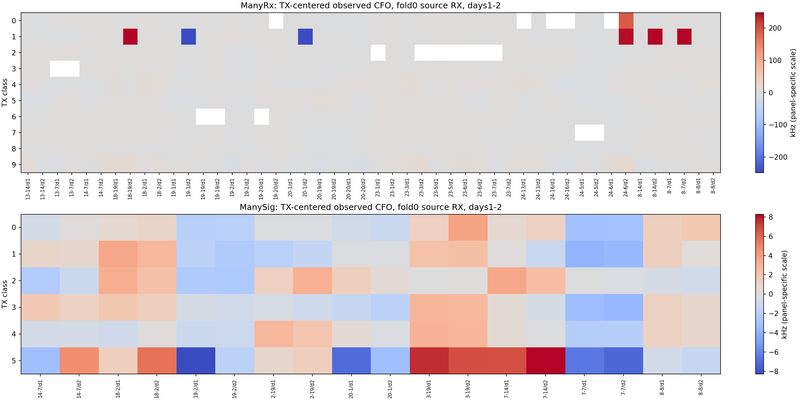

# CFO 源域补充描述性统计

本分析在看到CFO诊断输出后补充，不参与任何STOP/GO、频偏范围或预算选择。训练/门槛仍使用原预注册实现。
只使用已有source_cfo_packets.csv，不重新读取IQ。每个TX/RX/day先取可靠包（coherence≥0.7）的CFO中位数，形成等权cell。
TX中位数为跨RX/day的cell中位数；每个cell减去对应TX中位数，再按RX/day跨TX取中位数。该剩余量仍混合信道、交互与估计误差，不能叫作真实RX本振。

| 数据 | fold | TX中位数跨度 kHz | TX中心化后RX/day跨度 kHz | 其IQR kHz | 最低TX可靠比例 | 绝对剩余>50kHz的cell数 |
|---|---:|---:|---:|---:|---:|---:|
|ManyRx|0|24.07|4.60|2.07|0.833|7|
|ManyRx|1|24.18|6.29|1.93|0.844|4|
|ManyRx|2|24.41|6.46|2.26|0.854|5|
|ManyRx|3|23.71|6.38|2.24|0.854|5|
|ManySig|0|16.92|6.05|1.68|0.979|0|
|ManySig|1|15.04|4.36|1.39|0.986|0|
|ManySig|2|15.57|6.03|2.31|0.979|0|
|ManySig|3|16.69|6.14|1.18|0.983|0|

不同TX的观测CFO中位数存在关联，说明把每包总CFO归零会同时改变可能与TX身份有关的量。因此需要raw-only、corrected-only、raw+corrected以及双raw参数控制。
ManyRx还出现少量TX条件化后超过50kHz的长尾cell（完整清单见cfo_extreme_cells.csv），图中的大范围色标由这些值主导。它们可能来自实际大频偏，也可能来自重复结构/对齐问题；本分析没有天然真值，不能判定。高相关系数和合成增量误差通过均不保证天然CFO绝对准确。未据此事后删除样本或修改门槛。
此处没有天然CFO真值；不能从这个表推断天然分类错误由CFO造成，也不能声称已经唯一分离TX/RX频偏。
