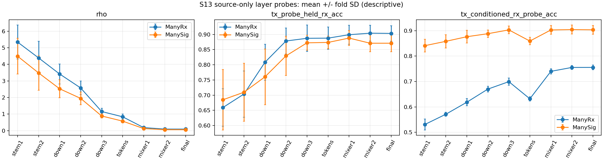

# P0 WiSig 源域机制诊断

状态：GO_CFO_SOURCE_PILOT。完成8/8个新源域诊断fit。

只使用各折合法源RX的第1–2天；原始pickle按字节跨度索引，仅解码获准cell，未载入目标RX/第3–4天IQ。

层级TX跨RX探针、控制TX后的RX探针和统一尺度rho见layer_probes.csv。

BN仅用70%fit训练分区重新校准；权重扰动是敏感性诊断，不是浅层无监督适配。没有验证师弟的微调等价性。

| 数据 | fold | STF可靠比例 | +CFO/20dB中位误差Hz | P95 Hz |
|---|---:|---:|---:|---:|
|ManyRx|0|0.933|485.19|1479.16|
|ManyRx|1|0.937|473.81|1446.88|
|ManyRx|2|0.939|479.88|1473.46|
|ManyRx|3|0.954|484.72|1466.19|
|ManySig|0|0.990|491.78|1495.55|
|ManySig|1|0.990|493.62|1499.96|
|ManySig|2|0.988|487.09|1476.90|
|ManySig|3|0.994|483.00|1478.77|

以下为4折描述性均值；TX probe只在fit-RX拟合、在留出源RX测试。RX probe使用各源RX互不重叠的包分区，控制TX均值后分类RX。

| 数据 | 层 | TX跨RX probe % | TX条件RX probe % | rho |
|---|---|---:|---:|---:|
|ManyRx|stem1|65.93|53.06|5.343|
|ManyRx|stem2|70.37|57.09|4.388|
|ManyRx|down1|80.84|61.84|3.417|
|ManyRx|down2|87.84|67.00|2.576|
|ManyRx|down3|88.73|69.94|1.154|
|ManyRx|tokens|88.78|63.19|0.834|
|ManyRx|mixer1|89.91|74.00|0.183|
|ManyRx|mixer2|90.41|75.54|0.093|
|ManyRx|final|90.33|75.56|0.093|
|ManySig|stem1|68.49|84.11|4.491|
|ManySig|stem2|70.96|85.82|3.481|
|ManySig|down1|76.04|87.64|2.525|
|ManySig|down2|82.94|88.83|1.946|
|ManySig|down3|87.24|90.34|0.884|
|ManySig|tokens|87.37|85.94|0.573|
|ManySig|mixer1|88.80|90.31|0.123|
|ManySig|mixer2|87.11|90.45|0.058|
|ManySig|final|87.11|90.36|0.058|

| 数据 | 干预 | 留出源RX准确率变化 pp，4折均值 |
|---|---|---:|
|ManyRx|BN_recal_fit_only|+0.211|
|ManyRx|stem_1pct|+0.002|
|ManyRx|mixer_1pct|-0.010|
|ManySig|BN_recal_fit_only|-0.156|
|ManySig|stem_1pct|-0.094|
|ManySig|mixer_1pct|-0.010|

合成CFO增量误差不等于天然CFO绝对误差；观测频偏不能唯一拆成TX和RX。
估计器门槛仅决定是否值得进行受控源域候选试验，不证明自然跨RX错误由CFO导致。
P2训练预算和分布界限需另行冻结提交；P3未启动。

这些结果不自动推出浅层适配有效。探针测试包可能与骨干fit包重合，跨RX的TX probe才是未参与骨干训练的源RX；连续采集包也不视为独立接收机重复。
