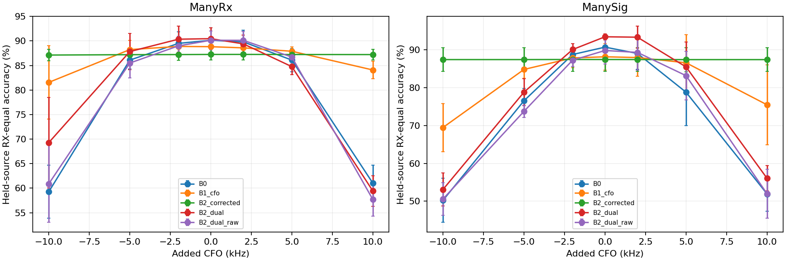

# WiSig CFO分类器级机制诊断

复用40个S13源域模型，没有新增训练。所有未扰动混淆矩阵与原记录一致。

完整逐RX/day、TX、coherence和观测CFO分组见cfo_classifier_groups.csv；同fold/seed/group的配对变化见cfo_paired_groups.csv。
组内先按RX等权，空组标为NA；TX单类组报告准确率/召回率，不把缺失TX计入一个误导性的Macro-F1。
重点判断raw+corrected是否同时优于raw-only和双raw参数控制；若双raw也同样改善，不能将参数收益归给CFO校正。

异常cell未删除，窗口/延迟诊断不用于修改校正起点、阈值或候选。长延迟估计存在不同无歧义范围，因此按模2π的相位一致性检查，不能直接比较Hz之差当作真误差。
没有天然CFO真值；观测CFO分组不能称为估计误差真值分组。RX/day、TX混合与包间相关性限制因果解读。
沿用S13既有STOP/GO，诊断不救活未通过的候选，不读取真实目标CRD。
