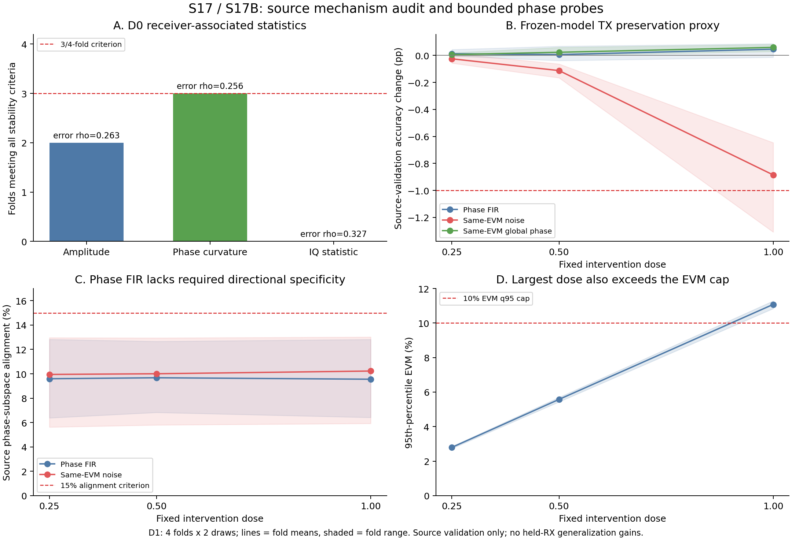

# S17 / S17B 最新结果复盘

截至2026-11-10，两轮均按固定出口结束。当前Windows原环境已恢复并通过GPU前反向检查，S17B的6项CPU/CUDA工程测试通过；此前DLL拦截和错误整体不变性断言的记录作为历史证据保留，WSL未安装。

本轮共新增4个端到端HStem+MHA基线训练、72组冻结模型的源验证干预与对照。没有训练新增增强方法，没有进入ManySig、独立seed或真实目标CRD评估。S15/S16原始结论与历史结果未改。

图B显示的是固定模型在合成干预后的源验证响应，不是训练新增模型获得的跨RX泛化收益。阴影为fold范围，不是置信区间。

## S17 D0：哪些差异值得进一步验证？

使用ManyRx四fold合法fit RX、日期1–2；描述子由split16001训练70%估计，减去TX/day条件均值。错误关联复用冻结S16 MHA的源验证混淆矩阵，使用TX宏平均错误率，日期合并；该关联条件于S16表示和训练配方。

| 代理量 | 满足全部稳定门槛的fold | 与错误的Spearman中位数 | 正相关fold | 本轮决定 |
|---|---:|---:|---:|---|
|幅频|2/4|0.263|4/4|未达到至少3个稳定fold，不建立自动增强候选|
|相位曲率|3/4|0.256|4/4|保留受控干预线索，后续另注册S17B|
|IQ伪协方差|0/4|0.327|3/4|缺少跨日/跨TX稳定性，不建立自动增强候选|

幅频并非完全没有RX相关差异：多个fold跨日相关很高，但fold1的跨TX复现性不足，fold3的RX识别率也略低于固定阈值。IQ统计虽有错误相关点估计，跨日相关仅−0.037至0.317，不能据此识别稳定的RX IQ失衡。

S17的`STOP_NO_STABLE_ERROR_LINK`仅指其预注册允许自动推进的幅频/IQ候选未通过全部条件。相位有线索，不能将这个状态名解读为“全部接收机相关效应均不存在”。完整数据见[S17 D0解释](https://github.com/hanCChan/crossatten/blob/exp/s17-rx-distortion/17-rx-distortion/D0_INTERPRETATION.zh-CN.md)。

## S17B D1：相位FIR能否覆盖真实观测到的差异？

S17B是在观察D0后提出的新探索问题：原S17 STOP保留，补充协议在读取任何本轮合成干预结果前注册。4个新MHA基线使用相同架构、source split16001，模型82,426参数；未扩大网络。

固定低阶平滑相位基、17tap复FIR、FFT512线性卷积和L1上限，强度仅0.25/0.5/1，两个固定draw。每个物理扰动有逐包EVM相同的高斯噪声和全局相位旋转对照。全部在fit RX验证30%运行：4 folds×3强度×2draw×3处理，共72组。

| 强度 | 源验证Accuracy变化pp | 源RX相位子空间对齐率 | EVM q95 | 停止原因 |
|---|---|---|---|---|
|0.25|−0.005至+0.044|6.4%–12.8%|2.74%–2.85%|覆盖量及方向对齐不足|
|0.5|−0.038至+0.068|6.8%–12.7%|5.44%–5.69%|方向对齐不足|
|1.0|−0.014至+0.087|6.4%–12.8%|10.84%–11.28%|方向对齐不足，且EVM q95超过10%上限|

表中范围为各fold双draw平均的最小值至最大值，不是统计区间。

三个强度均满足本轮TX分类保持代理；但物理FIR的相位子空间对齐率没有达到15%，也没有达到比同EVM噪声高0.02的额外要求。因此全部不准入，出口为 **STOP_D1_GATE**。没有放宽条件，也没有追加参数搜索来获得GO。

发布复盘额外计算显示，固定rank3子空间解释了标准化源RX profile方差的61.2%–71.5%。这一描述性统计不参与门槛、强度或模型选择。它支持将失败理解为“本次FIR未充分对齐主要观测方向”，仍不支持否定所有可能的相位机制或增强方法。记录见[POSTHOC_PCA_VARIANCE.json](POSTHOC_PCA_VARIANCE.json)。

## 工程假设修正

WiSig历史first-order实现保留FFT实部、虚部，再追加相邻相位差通道。附加通道的不变性不等于完整网络的不变性。原S17断言整体logits严格不变的测试失败得到保留；S17B改为验证正确的通道范围，并将全局相位作为实测对照。历史模型和数据处理未因此改变。

## 当前能得出的结论

1. 存在值得验证的RX相关相位统计线索，但该代理仍混有传播路径、天线、CFO、噪声和截取边界，没有唯一识别接收机硬件响应。
2. 本轮平滑相位FIR保持了源TX分类性能，却没有按预设指标覆盖足够特异的RX相关方向。当前没有得到可继续投入的新增泛化方法。
3. Pilot未启动，因此没有新的跨RX泛化准确率提升结论。继续这条路线需要更具体的物理响应或校准依据，另行预注册，不能直接扩大当前FIR的训练预算。

## 复核入口

- [S17B完整协议](README.zh-CN.md)与[原始注册](registration.json)
- [全部干预及失败门槛](D1_RESULTS.zh-CN.md)
- [72组CSV](D1_interventions.csv)与[原始JSON](D1_interventions.json)
- [最终访问和指标审计](FINAL_ACCESS_AUDIT.json)
- [逐基线配置、曲线、指标及checkpoint引用](final_evidence/MANIFEST.json)

新两阶段共288条源数据访问记录，均未读取留出源RX或真实目标RX/date3–4；4个本地checkpoint SHA、72条基线RX混淆矩阵及全部D1标量门槛已核验。IQ原始样本、模型权重与逐包预测保留本地，Git归档包含可复核的代码、配置、聚合指标、曲线和日志。
