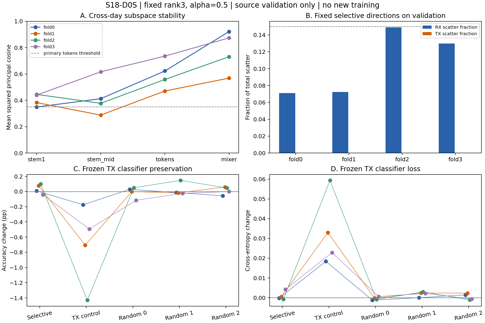

# S18 HStem选择性接收机表征：机制报告

源域决定：**STOP_D0_MECHANISM_GATE**。四fold共20组冻结方向干预，新增模型训练0；真实目标CRD、held-source、ManySig和独立seed均未读取或启动。

主要Tokens方向的稳定性与RX覆盖联合条件通过0/4 folds，分类特异性通过0/4，二者同时通过0/4。准入需要至少3/4且全部fold保持TX指标；这里的0/4不能解释成所有稳定RX差异均不存在。

图中仅是冻结模型对源验证数据的响应，各fold点不是独立随机种子，也不代表目标泛化收益。

## 结论与边界

当前固定rank3、alpha=.5、Tokens通道子空间方案未通过预先固定的联合门槛。保留负结果，停止B1–B4训练，不因本次结果继续搜索层、rank或强度。

这次观察支持的范围较窄：方向可以跨日和训练/验证重复，但跨TX稳定性只通过1/4；方向内TX类均值散度很低，却没有覆盖足够多的RX散度。高RX/TX比值本身不等于找到了分类器依赖的主要RX子空间。所有fold的源TX保持条件通过，仍未形成相对随机方向的稳定功能优势。

预选方向的验证RX散度占比为7.09%–14.88%，均低于15%门槛；TX散度占比仅0.0099%–0.0228%。随机平均与选择性CE差没有任何fold达到0.005门槛。

本结果不证明全部选择性表征或物理建模无效，也不证明TX/RX硬件已分离。Shen True In-Band与IB-RFF Information Bottleneck的区别、S10公平数字及已有S11/S12重叠见[协议审计](PROTOCOL_AUDIT.zh-CN.md)。

## 数据支持修正与可追溯性

原D0因完整cell假设在特征提取前触发支持检查，状态为`STOP_PRE_FEATURE_SUPPORT`，原注册和attempt保留。随后只核查源标签支持，在任何方向或干预结果产生前单独注册D0S；未改变模型、数据split、设备集合、rank、alpha、对照或门槛。

四fold有13/15/13/8个空cell（各360个），训练/验证空缺模式相同。D0S不插补也不删除整RX，使用TX条件RX散度和成对TX共同RX散度；完整矩形时后者严格还原原定义，缺失时估计的是共同支持条件下的差异。详见[修正说明](SUPPORT_AMENDMENT.zh-CN.md)与[支持计数](SUPPORT_AUDIT.json)。

## 冻结模型基线

| fold | 估计训练包 | 源验证包 | Accuracy % | Macro-F1 % | 最差RX % | 最差TX % | CE | margin |
|---|---:|---:|---:|---:|---:|---:|---:|---:|
| 0 | 16656 | 10401 | 94.6348 | 92.3812 | 80.5000 | 88.0802 | 0.16394 | 5.6239 |
| 1 | 16560 | 10341 | 97.1170 | 94.6356 | 91.7582 | 93.1071 | 0.11902 | 8.6365 |
| 2 | 16656 | 10401 | 92.4088 | 89.9455 | 81.5789 | 88.8767 | 0.24017 | 6.1706 |
| 3 | 16896 | 10560 | 94.0774 | 92.5990 | 81.2174 | 91.6895 | 0.18542 | 6.4947 |

各fold源RX等权Accuracy严格复现S17B冻结checkpoint，不能与S10真实CRD数字直接比较。

## 逐层方向稳定性

| fold | 层 | 包二分 | 跨日 | 跨TX半数 | 训练/源验证 | 验证RX散度占比 | 验证TX散度占比 | RX probe % |
|---|---|---:|---:|---:|---:|---:|---:|---:|
| 0 | stem1 | 0.555 | 0.349 | 0.203 | 0.595 | 0.0278 | 0.0004 | 14.87 |
| 0 | stem_mid | 0.536 | 0.412 | 0.138 | 0.461 | 0.0589 | 0.0004 | 18.07 |
| 0 | tokens | 0.728 | 0.622 | 0.291 | 0.800 | 0.0709 | 0.0001 | 22.80 |
| 0 | mixer | 0.797 | 0.922 | 0.071 | 0.821 | 0.0430 | 0.0001 | 18.18 |
| 1 | stem1 | 0.531 | 0.382 | 0.430 | 0.572 | 0.0259 | 0.0003 | 11.15 |
| 1 | stem_mid | 0.689 | 0.288 | 0.152 | 0.709 | 0.0464 | 0.0001 | 14.37 |
| 1 | tokens | 0.748 | 0.470 | 0.265 | 0.732 | 0.0724 | 0.0001 | 18.57 |
| 1 | mixer | 0.741 | 0.568 | 0.048 | 0.929 | 0.0227 | 0.0000 | 14.47 |
| 2 | stem1 | 0.759 | 0.445 | 0.115 | 0.766 | 0.0221 | 0.0003 | 14.53 |
| 2 | stem_mid | 0.369 | 0.377 | 0.164 | 0.538 | 0.0879 | 0.0004 | 21.01 |
| 2 | tokens | 0.528 | 0.558 | 0.356 | 0.607 | 0.1488 | 0.0002 | 24.17 |
| 2 | mixer | 0.623 | 0.731 | 0.173 | 0.778 | 0.0427 | 0.0001 | 15.33 |
| 3 | stem1 | 0.629 | 0.439 | 0.334 | 0.791 | 0.0563 | 0.0002 | 15.14 |
| 3 | stem_mid | 0.406 | 0.616 | 0.109 | 0.469 | 0.0887 | 0.0002 | 17.95 |
| 3 | tokens | 0.462 | 0.735 | 0.165 | 0.641 | 0.1299 | 0.0002 | 23.52 |
| 3 | mixer | 0.902 | 0.873 | 0.158 | 0.891 | 0.0978 | 0.0001 | 15.74 |

只预选Tokens作为主要干预位置；其余层不用于事后挑选。RX probe用TX/day标签作离线诊断，随机率1/18；该probe不进入分类推理。

## 冻结干预与对照

| fold | 方向 | ΔAcc pp | ΔF1 pp | ΔCE | Δmargin | 最差配对RX pp | 最差配对TX pp | RX散度减少 | TX散度减少 |
|---|---|---:|---:|---:|---:|---:|---:|---:|---:|
| 0 | selective | +0.0086 | +0.0415 | -0.00021 | -0.0820 | -0.372 | -0.296 | 0.0532 | 0.0001 |
| 0 | tx_dominant | -0.1741 | -0.1847 | +0.01840 | -0.5389 | -0.958 | -1.337 | 0.3694 | 0.7094 |
| 0 | random_0 | +0.0293 | +0.0834 | -0.00127 | +0.0174 | -0.342 | -0.188 | 0.0320 | 0.0586 |
| 0 | random_1 | -0.0128 | +0.0246 | -0.00002 | -0.0369 | -0.575 | -0.188 | 0.0643 | 0.0634 |
| 0 | random_2 | -0.0561 | -0.0556 | +0.00143 | -0.0223 | -0.491 | -0.818 | 0.0565 | 0.0336 |
| 1 | selective | +0.0771 | +0.1457 | +0.00051 | +0.0322 | -0.733 | -0.750 | 0.0543 | 0.0001 |
| 1 | tx_dominant | -0.7057 | -0.8741 | +0.03298 | -1.2166 | -2.525 | -6.893 | 0.2659 | 0.6839 |
| 1 | random_0 | -0.0012 | +0.0206 | -0.00021 | -0.0199 | -0.348 | -0.217 | 0.0399 | 0.0423 |
| 1 | random_1 | -0.0180 | -0.0277 | +0.00235 | -0.0637 | -0.506 | -0.278 | 0.0732 | 0.0579 |
| 1 | random_2 | +0.0595 | +0.0525 | +0.00232 | -0.0498 | -0.538 | -0.302 | 0.0345 | 0.0471 |
| 2 | selective | +0.1001 | +0.1829 | -0.00077 | -0.0004 | -0.327 | -0.445 | 0.1116 | 0.0002 |
| 2 | tx_dominant | -1.4301 | -1.6438 | +0.05937 | -0.9312 | -4.028 | -7.308 | 0.2102 | 0.6926 |
| 2 | random_0 | +0.0495 | +0.0532 | -0.00093 | -0.0336 | -0.701 | -0.267 | 0.0118 | 0.0232 |
| 2 | random_1 | +0.1467 | +0.1495 | +0.00294 | -0.0666 | -0.350 | -0.833 | 0.0587 | 0.0641 |
| 2 | random_2 | +0.0471 | +0.0854 | -0.00117 | -0.0426 | -0.712 | -0.356 | 0.0380 | 0.0414 |
| 3 | selective | -0.0416 | -0.0184 | +0.00420 | -0.0980 | -0.738 | -0.642 | 0.0974 | 0.0001 |
| 3 | tx_dominant | -0.4926 | -0.3931 | +0.02283 | -0.7674 | -1.661 | -4.607 | 0.3290 | 0.7137 |
| 3 | random_0 | -0.1150 | -0.1247 | +0.00060 | -0.0033 | -1.022 | -0.941 | 0.0164 | 0.0169 |
| 3 | random_1 | -0.0242 | -0.0099 | +0.00219 | -0.0818 | -0.738 | -0.960 | 0.0410 | 0.0903 |
| 3 | random_2 | -0.0010 | -0.0027 | -0.00072 | +0.0038 | -0.852 | -0.293 | 0.0404 | 0.0589 |

选择性相对三个随机对照平均的Accuracy差，按同一RX跨fold先平均：+0.0297pp，描述性RX聚类95%区间[-0.0657,+0.1226]pp，唯一RX身份数26。区间不涵盖训练随机性，也不能消除共享训练集造成的相关性。

所有干预rank/alpha一致，未匹配实际特征扰动能量；不能将随机方向与选择性方向的差异归因于相同能量下的完整因果机制。

## 逐fold联合门槛

| fold | 稳定性 | 特异性 | TX保持 | 未通过条件 |
|---|---|---|---|---|
| 0 | False | False | True | stable_tx_halves, rx_support, rx_scatter, random_ce |
| 1 | False | False | True | stable_tx_halves, rx_support, rx_scatter, random_ce |
| 2 | False | False | True | rx_support, random_ce |
| 3 | False | False | True | stable_packet_halves, stable_tx_halves, rx_support, random_ce |

门槛原值与所有布尔量见[机器决策](d0_support_matched/decision_d0.json)，没有放宽门槛或选取更有利的结果。

## 算法定义与未执行的Pilot

候选定义为训练源cell统计得到的U/中心，加有界残差 `z−0.5 U diag(sigmoid(theta)) Uᵀ(z−mu)`；推理不需RX/TX真值。D0S只检验固定g=1。alpha=.5时映射可逆，理想精确算术下不改变互信息；“软瓶颈”只描述有限网络中的几何抑制与归纳偏置。

| 臂 | 方法 | 本轮状态 |
|---|---|---|
| B0 | 既有HStem+MHA端到端模型 | 四fold冻结复用，仅诊断 |
| B1 | HStem+普通HSIC | 未训练；与完整IB-RFF分别报告 |
| B2 | 静态选择性方向 | 仅冻结干预，不等于训练后的B2 |
| B3 | 三参数有界学习门控 | 未训练 |
| B4 | 同参数随机方向门控 | 未训练；本轮只有静态随机方向干预 |

若将来提出新的研究，需重新注册并明确方向估计时点、所有臂对称预训练/warm-start、HSIC核及权重；不能把候选单独预训练后的收益归因于结构。当前STOP不自动开展新的方案。

## 参数与计算成本

| fold | 参数 | 核心dense FLOPs/包 | 静态投影额外FLOPs/包 | B0 batch1 ms | 静态 batch1 ms | B0 batch128 ms | 静态 batch128 ms |
|---|---:|---:|---:|---:|---:|---:|---:|
| 0 | 82426 | 10,274,048 | 24,576 | 2.159 | 2.287 | 2.283 | 2.255 |
| 1 | 82426 | 10,274,048 | 24,576 | 2.750 | 2.502 | 2.159 | 2.314 |
| 2 | 82426 | 10,274,048 | 24,576 | 2.165 | 2.384 | 2.433 | 2.413 |
| 3 | 82426 | 10,274,048 | 24,576 | 2.290 | 2.322 | 2.262 | 2.292 |

FLOPs按2/MAC，只计Conv/Linear/attention乘积，不含FFT、norm、激活、softmax与逐元素算子。GPU为RTX4060 Laptop，FP32、每配置10次warm-up/30次同步实测；延迟含Python hook及同步方式，是本机描述性测量。静态模块新增训练参数0、固定basis/center256 floats；B3/B4设计各3参数，未把设计值伪装为已训练实测。

## 证据与复现

- [原注册](registration.json)、[D0S注册](registration_support.json)、[原支持STOP](D0_SUPPORT_STOP.json)
- [逐fold原始JSON](d0_support_matched/D0_fold0.json)、[全部干预CSV](D0_interventions.csv)、[最终审计](FINAL_ACCESS_AUDIT.json)
- 本地`d0_support_matched/cache/features_f*.npz`保存源训练/验证池化特征及索引，SHA在原始JSON；原始IQ、checkpoint和逐包特征不进Git。
- 工程测试包含16项原测试及支持修正测试；实际结果复核检查注册代码/历史证据SHA、混淆矩阵指标、散度/方向、门槛和源访问范围。

证据限制：本地特征缓存没有逐包logits；独立QA从混淆矩阵重新计算Accuracy/F1/TX指标，并重新估计散度和方向。CE/margin核验覆盖RX聚合、差值与门槛一致性，未独立从逐包logits再算。原始源IQ与冻结权重的SHA及代码仍提供完整计算复现入口。

现有模型已在方向估计训练样本上训练；源验证已参与历史checkpoint选择，因此本轮不是独立确认。mean pooling未覆盖完整Token位置交互，RX散度混有信道/同步，TX类均值散度不穷尽非线性判别信息。完整限制见[方法定义](README.zh-CN.md)。

没有新增真实CRD比较结果，不能宣称超越IB-RFF或ASKNet。
