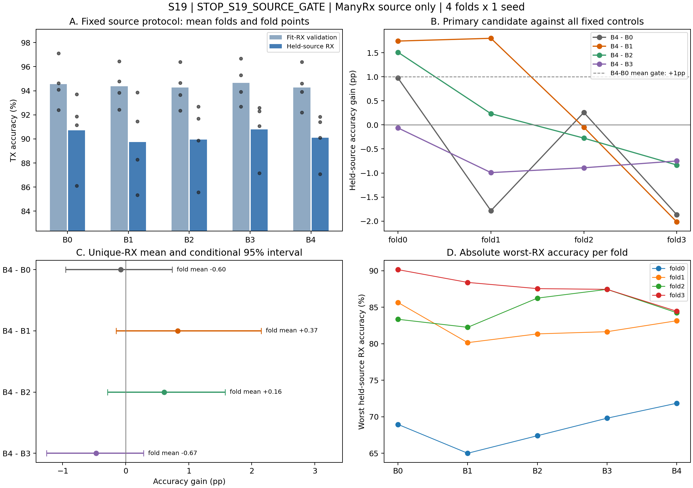
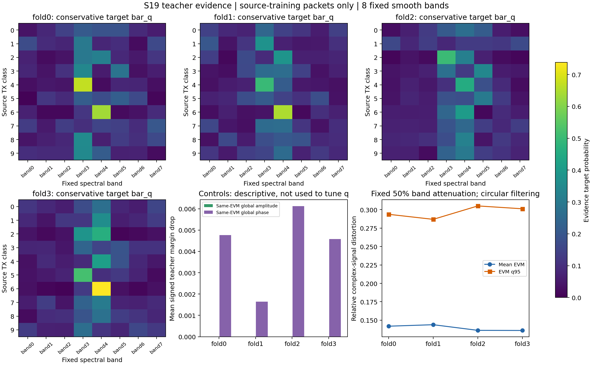

# S19：统一RF表征与TX频谱证据学习结果

源域决定：**STOP_S19_SOURCE_GATE**。完成ManyRx四fold×五臂，16次新增正式训练、4个严格复用B0。

本轮未通过预先固定的源域联合门槛，停止当前固定TCSE方案；不追加band、门控结构、调制强度或loss系数搜索，不启动条件扩展。

主要比较B4−B0：fold平均-0.6046pp，正向2/4 folds，最差配对RX-6.8500pp；按唯一RX身份汇总的均值-0.0787pp，描述性条件95%区间[-0.9533, +0.7398]pp。

监督独立比较B4−B3：fold平均-0.6741pp，正向0/4 folds，条件95%区间[-1.2543, +0.2824]pp。B4相对同结构B3没有通过独立收益门槛，因此不能宣称新的TX证据监督带来正向收益。即便某个其他对照正向，也不改推其他实验臂。

图表只描述本轮固定源域评估，不参与重新选参或换臂。Source validation是fit RX包留出，held-source是本fold训练时留出的源RX；两者均不是实际目标CRD。

## 固定设计与实际执行

本研究继承S18本地提交`933d4a6`，完整43个归档文件已核验；S00–S18有效证据、负结果和STOP未改，见[historical_matrix.md](historical_matrix.md)和[S18_VERIFIED.json](S18_VERIFIED.json)。S03的LoRa HSTU、S07 ManyRx和S08 ManySig历史成绩不是一个统一算法的最终成绩。

| 臂 | 固定定义 | 参数 | 本轮训练角色 |
|---|---|---:|---|
| B0 | 原HStem+MHA | 82,426 | 历史源域checkpoint严格复用；同时作为固定teacher |
| B1 | 静态可学习8band滤波 | 82,434 | 从匹配随机主干初值训练，仅CE |
| B2 | 参数匹配power门控 | 82,698 | 从匹配随机主干初值训练，仅CE |
| B3 | TCSE结构+CE | 82,698 | 从匹配随机主干初值训练，仅CE |
| B4 | TCSE结构+CE+证据监督 | 82,698 | 从匹配随机主干初值训练，CE+0.1证据CE |

B2/B3/B4均新增272参数，B3/B4同结构、同初值；仅B4增加监督。B1新增8个参数，是一般可学习频谱滤波的机制控制，不是FAN/ASKNet完整模型复现。普通频谱模块不能重新包装成原创贡献。

每fold官方24个源RX中first6作held-source、余18个fit；日期1–2、10TX、256点、non-equalized、first100/TX/RX/day。fit70/30 split16001，seed18101及B0原data_seed，Adam1e-3/wd0/batch128/FP32/最多40epochs，Plateau(.1,5,min1e-6)、earlywait10。所有新臂匹配主干初值与每epoch包顺序，仅fit-RX等权验证CE选checkpoint/调LR，不用辅助损失选模。

全部20个checkpoint及元数据在读取本轮held-source前封存并commit，见[seal_pilot.json](seal_pilot.json)。held-source仅在封存后一次性评价；同名源接收机曾被历史研究使用，本轮held-source不能称为历史上从未看过的独立RX。新确认分组/seed仍是后续独立阶段，不能由本次数据替代。

## 预注册联合门槛逐项结果

| 比较 | fold均值 ΔAcc pp | 正向fold | 最差配对RX pp | 唯一RX数 | 唯一RX均值 pp | 条件95%区间 pp | 门槛检查 |
|---|---:|---:|---:|---:|---:|---|---|
| B4−B0 | -0.6046 | 2/4 | -6.8500 | 12 | -0.0787 | [-0.9533, +0.7398] | mean=FAIL；folds=FAIL；interval=FAIL；worst_rx=FAIL |
| B4−B1 | +0.3690 | 2/4 | -5.1000 | 12 | +0.8269 | [-0.1542, +2.1479] | mean=PASS；folds=FAIL；interval=FAIL |
| B4−B2 | +0.1586 | 2/4 | -3.1000 | 12 | +0.6088 | [-0.2871, +1.5778] | mean=PASS；folds=FAIL；interval=FAIL |
| B4−B3 | -0.6741 | 0/4 | -5.0500 | 12 | -0.4704 | [-1.2543, +0.2824] | mean=FAIL；folds=FAIL；interval=FAIL |

B4−B0需fold均值≥+1pp、至少3/4正向、最差配对RX≥−2pp、条件CI下界>0。B4−B1/B2/B3各需fold均值>0、至少3/4正向及条件CI下界>0；所有条件共同通过才准入。只有B4预选为主要候选，未依据结果改推其他臂。机器决定见[decision_pilot.json](decision_pilot.json)。

fold均值先在各fold对RX等权再平均，会重复计入跨fold出现的同一RX；bootstrap则先将同一RX跨fold的差值平均，再对唯一身份等权重抽样5000次（seed19191）。因此fold均值和唯一RX均值可能不同，不能将一种加权的点估计与另一种区间混说。该区间不消除共享训练集/模型依赖，也不覆盖训练随机种子不确定性；包、日期、TX和重复fold不是新增独立RX。

## 所有实验臂的配对指标

| 评估角色 | 臂 | 四fold平均Acc % | 四fold平均Macro-F1 % | CE | TX margin | fold最差RX准确率的平均 % |
|---|---|---:|---:|---:|---:|---:|
| fit-RX验证 | B0 | 94.5595 | 92.3903 | 0.17714 | 6.7314 | 83.7636 |
| fit-RX验证 | B1 | 94.3717 | 92.2970 | 0.17647 | 6.2147 | 82.9971 |
| fit-RX验证 | B2 | 94.2576 | 92.1397 | 0.18016 | 5.9391 | 83.2957 |
| fit-RX验证 | B3 | 94.6420 | 92.5103 | 0.17329 | 6.4681 | 83.5533 |
| fit-RX验证 | B4 | 94.2663 | 92.0653 | 0.17852 | 6.1500 | 82.8419 |
| held-source | B0 | 90.7118 | 90.0257 | 0.34389 | 5.8120 | 82.0250 |
| held-source | B1 | 89.7382 | 88.9222 | 0.38386 | 5.2191 | 78.9500 |
| held-source | B2 | 89.9486 | 89.1136 | 0.36958 | 5.0626 | 80.6375 |
| held-source | B3 | 90.7812 | 90.0547 | 0.33916 | 5.5573 | 81.5875 |
| held-source | B4 | 90.1072 | 89.2583 | 0.36046 | 5.3151 | 80.9250 |

上表最差RX列是“每fold最差RX准确率”的四fold平均，不能替代门槛中的所有配对RX变化最小值。逐fold全量如下。

| fold | 臂 | 角色 | Acc % | Macro-F1 % | CE | TX margin | 最差RX % | 最差TX % |
|---|---|---|---:|---:|---:|---:|---:|---:|
| 0 | B0 | fit验证 | 94.6348 | 92.3812 | 0.16394 | 5.6239 | 80.5000 | 88.0802 |
| 0 | B0 | held源 | 86.1139 | 84.7872 | 0.53311 | 4.2485 | 68.9500 | 74.5833 |
| 0 | B1 | fit验证 | 94.7873 | 92.6503 | 0.16217 | 5.5566 | 80.8333 | 85.6540 |
| 0 | B1 | held源 | 85.3444 | 84.2905 | 0.54550 | 3.9893 | 65.0000 | 77.3333 |
| 0 | B2 | fit验证 | 94.6469 | 92.5707 | 0.16483 | 5.5828 | 81.5000 | 85.5485 |
| 0 | B2 | held源 | 85.5778 | 84.2896 | 0.53727 | 4.1949 | 67.4000 | 77.7500 |
| 0 | B3 | fit验证 | 95.2923 | 93.2024 | 0.15701 | 6.4990 | 82.3333 | 89.1350 |
| 0 | B3 | held源 | 87.1500 | 85.9595 | 0.50728 | 4.9927 | 69.8000 | 78.6667 |
| 0 | B4 | fit验证 | 94.5890 | 92.2406 | 0.16684 | 5.6055 | 81.8333 | 86.9281 |
| 0 | B4 | held源 | 87.0870 | 86.1074 | 0.46538 | 4.4557 | 71.8500 | 80.9167 |
| 1 | B0 | fit验证 | 97.1170 | 94.6356 | 0.11902 | 8.6365 | 91.7582 | 93.1071 |
| 1 | B0 | held源 | 91.8750 | 91.3546 | 0.33741 | 7.2768 | 85.6500 | 74.8333 |
| 1 | B1 | fit验证 | 96.4409 | 94.1190 | 0.11562 | 6.5684 | 90.1099 | 90.4659 |
| 1 | B1 | held源 | 88.2917 | 87.1047 | 0.45399 | 5.0848 | 80.1500 | 70.5000 |
| 1 | B2 | fit验证 | 96.3820 | 93.8400 | 0.12287 | 6.3945 | 90.1099 | 89.2741 |
| 1 | B2 | held源 | 89.8583 | 88.7656 | 0.39854 | 5.1079 | 81.3500 | 79.9167 |
| 1 | B3 | fit验证 | 96.6743 | 94.2720 | 0.11755 | 6.6591 | 90.4762 | 94.0412 |
| 1 | B3 | held源 | 91.0833 | 90.1866 | 0.33127 | 5.4739 | 81.6500 | 83.8333 |
| 1 | B4 | fit验证 | 96.3802 | 93.9345 | 0.11986 | 6.4668 | 89.0110 | 91.9406 |
| 1 | B4 | held源 | 90.0917 | 88.9256 | 0.35578 | 5.2773 | 83.1500 | 77.1667 |
| 2 | B0 | fit验证 | 92.4088 | 89.9455 | 0.24017 | 6.1706 | 81.5789 | 88.8767 |
| 2 | B0 | held源 | 91.1500 | 90.5934 | 0.30360 | 5.6788 | 83.3500 | 75.8333 |
| 2 | B1 | fit验证 | 92.4259 | 90.1049 | 0.24093 | 6.0493 | 80.1754 | 88.8767 |
| 2 | B1 | held源 | 91.4583 | 90.7500 | 0.32066 | 5.6343 | 82.2500 | 75.8333 |
| 2 | B2 | fit验证 | 92.3515 | 89.9996 | 0.24202 | 5.6198 | 80.8772 | 89.7683 |
| 2 | B2 | held源 | 91.6833 | 91.1429 | 0.30040 | 5.2793 | 86.2500 | 79.6667 |
| 2 | B3 | fit验证 | 92.6848 | 90.1657 | 0.23179 | 6.1908 | 81.4035 | 88.7665 |
| 2 | B3 | held源 | 92.3000 | 91.9062 | 0.27510 | 5.7704 | 87.4500 | 84.6667 |
| 2 | B4 | fit验证 | 92.1968 | 89.6962 | 0.24048 | 6.3461 | 80.1754 | 87.8896 |
| 2 | B4 | held源 | 91.4083 | 90.7814 | 0.32366 | 5.9624 | 84.2500 | 76.4167 |
| 3 | B0 | fit验证 | 94.0774 | 92.5990 | 0.18542 | 6.4947 | 81.2174 | 91.6895 |
| 3 | B0 | held源 | 93.7083 | 93.3678 | 0.20143 | 6.0439 | 90.1500 | 86.3333 |
| 3 | B1 | fit验证 | 93.8328 | 92.3138 | 0.18717 | 6.6844 | 80.8696 | 91.1602 |
| 3 | B1 | held源 | 93.8583 | 93.5435 | 0.21530 | 6.1683 | 88.4000 | 82.5000 |
| 3 | B2 | fit验证 | 93.6500 | 92.1484 | 0.19092 | 6.1592 | 80.6957 | 89.6353 |
| 3 | B2 | held源 | 92.6750 | 92.2563 | 0.24211 | 5.6684 | 87.5500 | 83.4167 |
| 3 | B3 | fit验证 | 93.9165 | 92.4011 | 0.18680 | 6.5237 | 80.0000 | 91.4956 |
| 3 | B3 | held源 | 92.5917 | 92.1665 | 0.24299 | 5.9923 | 87.4500 | 84.2500 |
| 3 | B4 | fit验证 | 93.8990 | 92.3899 | 0.18689 | 6.1817 | 80.3478 | 90.6910 |
| 3 | B4 | held源 | 91.8417 | 91.2186 | 0.29701 | 5.5651 | 84.4500 | 76.2500 |

每RX Macro-F1按模型声明的10个TX类别计算；原支持中的缺失类不被删除。TX真值仅用于训练损失和离线评分，分类前向只输入IQ。

## 训练频谱证据、能量匹配对照与伪迹

| fold | 证据训练包 | 每TX源RX数范围 | q数值范围 | EVM均值 | EVM q95 | 平均保留谱能量 | 幅度控制Δmargin均值 | 相位控制Δmargin均值 | EVM匹配最大误差 |
|---|---:|---|---|---:|---:|---:|---:|---:|---:|
| 0 | 5552 | 17–18 | 0.00891–1.37642 | 0.14184 | 0.29372 | 0.90458 | +0.000001 | +0.004767 | 8.94e-08 |
| 1 | 5520 | 17–18 | 0.03550–2.37877 | 0.14387 | 0.28688 | 0.90451 | +0.000002 | +0.001648 | 8.94e-08 |
| 2 | 5552 | 17–18 | 0.01414–0.96525 | 0.13620 | 0.30509 | 0.90462 | +0.000002 | +0.006119 | 8.94e-08 |
| 3 | 5632 | 17–18 | 0.01107–1.04590 | 0.13604 | 0.30121 | 0.90468 | +0.000001 | +0.004582 | 8.94e-08 |

q只来自固定teacher在fit训练70%中每非空TX/RX/day cell最多16包的输出。先cell均值、再对可观测day等权、最后跨有支持RX取线性Q0.25；缺失cell不插补、不删除整RX。不同TX的RX/day支持可以不同，完整counts/mask均保留在[evidence_f0.json](evidence_f0.json)及其他fold记录中。

teacher已在这些源训练样本上训练，其checkpoint曾用历史源验证CE选择。因此q是该teacher依赖关系的代理，不是独立于选模的TX硬件真值；低分位数也不能保证去除了所有接收机捷径。B4没有额外held或目标监督，但确实使用了一个预训练teacher的输出，成本和信息来源单独报告。

证据估计固定削弱单band 50%，得到EVM q95范围0.2869–0.3051；训练门控的归一化前幅度调制仅±20%。两者扰动尺度不同，较大遮蔽下的teacher依赖不保证是局部调制下的最优证据。该差异作为设计限制披露，没有据此改参数或增删正式fit。

全谱幅度缩放和全局相位旋转与每包遮蔽EVM匹配，最大绝对匹配误差8.94e-08。幅度控制检查总能量/归一化效应；相位控制检查非频段特异的相位敏感性，不能假设原Re/Im网络对全局相位完全不变。两种控制均只描述，没有从q中扣除、重选band或修改遮蔽强度。

遮蔽通过复数FFT→平滑频谱幅度mask→IFFT实现，是圆周滤波，可能有时域ringing；残差filter impulse在±4sample外的能量比例范围0.1553–0.1553。这不是识别RX硬件传递函数，也不证明无伪迹。热图为固定bar_q目标，不是目标域后验重要性图。

所有动态/静态gain先在同一复谱上作用，再重算Re/Im、LogMag和相位valid mask；±20%界只约束归一化前的谱幅度gain，不适用于重新归一化后的每个RF通道。生产推理用Parseval相对RMS校正避免IFFT往返，teacher遮蔽则保留显式IFFT以保持反事实路径清楚。

## 参数、推理路径与训练成本

| 臂 | 参数 | 相对B0新增 | 部分算术估计/包 | batch1中位延迟 ms | batch128中位延迟 ms |
|---|---:|---:|---:|---:|---:|
| B0 | 82,426 | 0 | 10,284,288 | 2.9415 | 2.8236 |
| B1 | 82,434 | 8 | 10,288,384 | 3.1739 | 3.2920 |
| B2 | 82,698 | 272 | 10,292,992 | 3.2271 | 6.6207 |
| B3 | 82,698 | 272 | 10,301,184 | 6.2904 | 4.1964 |
| B4 | 82,698 | 272 | 10,301,184 | 5.7502 | 4.1957 |

16个新增fit累计计时711.77s（11.86min）；4个复用B0/teacher历史训练累计94.44s，按同一checkpoint只计一次；本轮teacher证据推理累计19.85s。若从零构建本研究，需同时计入teacher训练，不能只计新增272参数或B4推理开销。计时不等于完整阶段墙钟时间，封存、held评价、复核和报告等未完全包含。

每包证据估计有1次clean加8×3次teacher forward，即25次；这些只在训练证据构造时发生，推理不运行teacher。各臂训练epoch、早停点、日志和配置完整保留，并没有把较早停止的臂补训或重复试种子。

推理路径包含原RMS、一次FFT256、band描述子/有界gain、复谱调制后全部五通道重建、HStem、普通两层MHA和分类头。B3/B4另需一次用于phase描述子的原五通道构造，不能只用参数数目推断真实成本。

[COSTS.json](COSTS.json)保存完整路径、算子清单、计时样本和SHA来源。实测设备为NVIDIA GeForce RTX 4060 Laptop GPU，FP32、固定合成输入，计时包含Python dispatch和CUDA同步。部分算术subtotal只覆盖声明的Conv/Linear/attention/频带矩阵乘积和FFT代理；未计齐norm、log1p、softmax、elementwise等，**不能称完整总FLOPs**。算子profile只作清单，不能补成完整总FLOPs。

B3/B4架构相同，其延迟数值差异是本机单次benchmark的描述性波动，不能归因于架构差异。

## 访问审计、验证范围与后续出口

[FINAL_ACCESS_AUDIT.json](FINAL_ACCESS_AUDIT.json)状态为PASS。从保存的逐包teacher/source/held logits重新计算q、CE、margin、Accuracy、Macro-F1、最差RX/TX和配对门槛；核对主干初值SHA、B3/B4完整初值、共用epoch顺序、checkpoint/代码/协议SHA及held读取晚于封存。审计本身不再运行模型或打开原始IQ。

本轮没有访问真实目标RX/date3–4，没有训练或评估ManySig、Shen TrueIB、Shen blind、额外seed或更换源RX确认分组。S10官方公平重训IB-RFF/ASKNet结果保留在历史矩阵中，不能拿本轮held-source准确率直接声称超过其CRD结果。

已核对的LoRa统一基线为Shen TrueIB+HStem+MHA：Fs1MHz、BW125kHz、8192点、|f|≤62.5kHz，133,690参数及原legacy5输入。WiSig使用Fs25MHz、256点和原频域五通道；本轮没有把LoRa裁频界复制到WiSig，也没有将S03 HSTU成绩替代MHA基线。LoRa适配仍待源域准入后独立验证。

按预注册STOP，不开展source-last/新seed确认、ManySig或Shen训练，不重新搜索gate/lambda/band。保留HStem已有有效证据和本轮负结果，不能将未通过的TCSE候选写成论文贡献。

## 复核入口

- [设计与算法定义](README.zh-CN.md)、[历史矩阵](historical_matrix.md)、[预注册](registration.json)
- [全部配对比较CSV](PILOT_COMPARISONS.csv)、[机器决定](decision_pilot.json)、[checkpoint封存](seal_pilot.json)
- [训练证据fold0](evidence_f0.json)、其余evidence_f1–3.json，以及runs/下全部配置、曲线、日志、源/held混淆矩阵
- [成本](COSTS.json)、[最终审计](FINAL_ACCESS_AUDIT.json)、[归档SHA](MANIFEST.json)

原始IQ、模型权重、逐包预测及证据数组只保留本地并由SHA引用；Git归档包含代码、设计、聚合统计、日志、配置、checkpoint引用、决策和图表。派生报告不参与选模。
