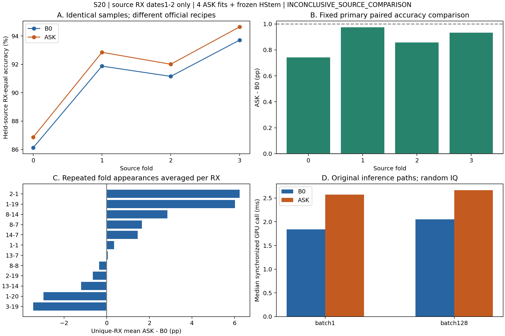

# S20：同数据源域 HStem+MHA / ASKNet 正面对照

结果分类：**INCONCLUSIVE_SOURCE_COMPARISON**。新增4次官方路径ASKNet训练，严格复用4个S19 B0；没有新模块、额外seed或真实目标CRD评估。

ASK−B0的四fold平均Accuracy差 **+0.8773pp**，正向4/4，最差配对RX **-8.0500pp**。按12个唯一RX身份等权的均值+0.8324pp，描述性条件95%区间[-0.7681,+2.6029]pp。

本轮结论是同数据、同评价条件下**整体模型与官方配方**的比较；不能把差距直接解释为Koopman、复数谱、截止或Patch的因果贡献。官方ASKNet最多200轮、按包等权CE选模；冻结B0最多40轮、按RX等权CE选模，数据shuffle路径也不同。差异均在读取新ASK held结果前固定。

本轮ASK的源域平均优势在四fold方向一致，不能写成“没有平均收益”；但幅度未达+1pp，RX异质性很大且条件区间跨零。INCONCLUSIVE不等于无差异、方法等价或验证协议失效。历史S07/S08也不是本轮S19 B0这组同输入/同MHA/同配方模型，因此本结果不是对这对模型真实CRD排序的严格复现。它支持进一步核查配方与接收机风险的必要性，尚不支持指定某个算子为下一项创新来源。

## 首轮比较与出口

| fold | B0 Accuracy % | ASK Accuracy % | ASK−B0 pp | ΔMacro-F1 pp | 最差配对RX pp |
|---|---:|---:|---:|---:|---:|
| 0 | 86.1139 | 86.8565 | +0.7426 | +0.6684 | -1.2000 |
| 1 | 91.8750 | 92.8500 | +0.9750 | +1.1720 | -2.0000 |
| 2 | 91.1500 | 92.0083 | +0.8583 | +1.1069 | -8.0500 |
| 3 | 93.7083 | 94.6417 | +0.9333 | +1.1037 | -2.0500 |

操作性‘明显优势’要求fold均值≥1pp、3/4正向、最差配对RX≥−2pp及唯一RX条件CI下界>0。ASK通过：False；HStem反方向通过：False；描述性接近条件通过：False。机器决定见[decision.json](decision.json)。

本轮没有建立ASK在这套源RX协议上稳定优于冻结HStem的前提。不能因此证明两方法普遍等价，或证明源协议失效；应先审视覆盖、分组及seed不确定性，而不是继续增加新模块。

fold等权均值和唯一RX等权均值是不同加权。fold1–3反复使用同6个held-source身份，加上fold0的另6个，总计12个唯一RX，不能当24个独立接收机。CI按同RX跨fold先平均，再bootstrap5000次、seed20101；不覆盖共享训练集和单macro-seed的不确定性。95%CI跨零不意味着等价；“接近”只有当区间完全位于±1pp且|fold均值|<1pp才成立，仍不是总体等价检验。

## 全部配对指标

| fold | 模型 | 角色 | Acc % | RX Macro-F1 % | RX等权CE | TX margin | 最差RX % | 最差TX % |
|---|---|---|---:|---:|---:|---:|---:|---:|
| 0 | B0 | fit验证 | 94.6348 | 92.3812 | 0.16394 | 5.6239 | 80.500 | 88.080 |
| 0 | B0 | held源 | 86.1139 | 84.7872 | 0.53311 | 4.2485 | 68.950 | 74.583 |
| 0 | ASK | fit验证 | 94.1913 | 92.0239 | 0.21231 | 6.5297 | 81.667 | 89.768 |
| 0 | ASK | held源 | 86.8565 | 85.4555 | 0.65589 | 5.4046 | 71.800 | 76.250 |
| 1 | B0 | fit验证 | 97.1170 | 94.6356 | 0.11902 | 8.6365 | 91.758 | 93.107 |
| 1 | B0 | held源 | 91.8750 | 91.3546 | 0.33741 | 7.2768 | 85.650 | 74.833 |
| 1 | ASK | fit验证 | 95.6647 | 93.0550 | 0.15806 | 7.7755 | 86.264 | 92.047 |
| 1 | ASK | held源 | 92.8500 | 92.5266 | 0.22597 | 6.3346 | 88.650 | 86.667 |
| 2 | B0 | fit验证 | 92.4088 | 89.9455 | 0.24017 | 6.1706 | 81.579 | 88.877 |
| 2 | B0 | held源 | 91.1500 | 90.5934 | 0.30360 | 5.6788 | 83.350 | 75.833 |
| 2 | ASK | fit验证 | 91.9118 | 89.4059 | 0.29533 | 5.9851 | 79.825 | 88.606 |
| 2 | ASK | held源 | 92.0083 | 91.7003 | 0.22796 | 5.1920 | 87.100 | 83.250 |
| 3 | B0 | fit验证 | 94.0774 | 92.5990 | 0.18542 | 6.4947 | 81.217 | 91.689 |
| 3 | B0 | held源 | 93.7083 | 93.3678 | 0.20143 | 6.0439 | 90.150 | 86.333 |
| 3 | ASK | fit验证 | 93.2411 | 91.6234 | 0.25766 | 6.4395 | 80.174 | 88.868 |
| 3 | ASK | held源 | 94.6417 | 94.4715 | 0.18211 | 5.5754 | 92.000 | 88.417 |

逐RX配对表见[PAIRED_RECEIVERS.csv](PAIRED_RECEIVERS.csv)；各模型混淆矩阵在runs下。所有Macro-F1按声明的10TX类计算，不删除原支持缺失类。最差配对变化与绝对最差RX准确率不是同一统计量。

一个描述性差异是：ASK在fit RX包留出的验证Accuracy上四fold均低于B0，却在held-source RX上四fold均高于B0。因此，已见RX的包验证准确率和未参加训练RX的准确率不能互相替代；它不自动说明哪一种架构或正则机制负责。

最差配对位于fold2的RX `3-19`：B0 95.15%、ASK 87.10%，共2000包、ASK多错161包。该定位只是同一冻结输出的描述，不能据此归因于频带或Koopman。完整逐TX错误变化见[ERROR_LOCALIZATION.json](ERROR_LOCALIZATION.json)。

该最差配对的增错主要集中于TX索引1和4，分别净增加82和66个错误。没有据此追加频带/算子消融或调整模型，这不是剪裁/Koopman造成错误的因果证明。

## 复用、配方及选模审计

S10的12个ManyRx官方重训均使用全部24个source RX，已见本轮held6且split/seed不同，因此0个可严格复用；没有读取这些权重。S19的167个归档文件逐SHA核验，B0权重和既有source/held logits严格复用，未改或续训。详见[REUSE_AUDIT.json](REUSE_AUDIT.json)。

| fold | ASK训练轮数 | 包CE选中epoch | RX等权CE诊断最优epoch | checkpoint截止k | 训练计时秒 |
|---|---:|---:|---:|---:|---:|
| 0 | 38 | 28 | 28 | 32 | 52.26 |
| 1 | 39 | 29 | 29 | 32 | 51.29 |
| 2 | 40 | 30 | 30 | 32 | 53.38 |
| 3 | 44 | 34 | 34 | 48 | 60.20 |

四fold ASK的包CE最优epoch与RX等权CE最优epoch在本次曲线上恰好一致；没有观测到这两种加权在已发生的ASK轨迹上改变checkpoint选择。它不消除LR/earlystop依据和训练时长的潜在配方差异。RX等权CE仅作日志审计，没有据此另测或替换官方checkpoint。官方函数直接负责优化、LR、earlystop和保存；包装只记录原CPU DataLoader实际顺序及原验证forward输出。全部新模型先封存并commit，再一次性读取本轮held-source。B0的历史held结果不是全新独立证据。

工程事件：四次训练均成功，原封存函数拼装B0引用时重复传入fold字段而触发TypeError，尚未读取本轮held数据。原代码和注册保持不变；以单独提交的[s20_seal_finish.py](s20_seal_finish.py)修复字典序列化交接，见[ENGINEERING_HANDOFF.json](ENGINEERING_HANDOFF.json)。四个权重及source结果SHA未改，重复fit为0，未修改预测、选模或门槛。补充代码和全部checkpoint先commit封存，再调用原注册的评价及决策函数。

## 结构描述：不等于归因

| fold | 截止k | K酉性相对Fro误差 | K距identity相对Fro | K非对角能量比例 | eigenphase圆均值长度 |
|---|---:|---:|---:|---:|---:|
| 0 | 32 | 1.062e-06 | 0.31651 | 0.095905 | 0.94991 |
| 1 | 32 | 1.121e-06 | 0.32798 | 0.103137 | 0.94622 |
| 2 | 32 | 1.042e-06 | 0.35423 | 0.119659 | 0.93727 |
| 3 | 48 | 1.065e-06 | 0.35888 | 0.122588 | 0.93568 |

ASK先做中心候选硬截止，再对最大127个复数模态施加U diag(exp(iθ)) Uᴴ，之后IFFT、总能量归一化和64sample/stride32的时间Patch，产生7×128 tokens。K可把已选模态的能量组合到最大低频窗口内其他模态；这些显式交互不是只缩放实数幅度。

HStem沿完整频谱五通道（Re/Im/LogMag/邻频phase）构建32×64频率坐标tokens，再用普通MHA全局交互；它也能学习跨频率关系，不能简单说它“没有频率交互”。HStem预attention局部感受野32频点/hop8，与ASK的64个重建时域sample单位不同，不能直接比较两个数字。K的酉性、非对角能量与截止位置只是已学习权重的描述，不证明性能差由这些因素造成。

## 参数与同机实际延迟

| 模型 | 参数元素 | 实标量自由度 | batch1 median ms | batch128 median ms |
|---|---:|---:|---:|---:|
| B0 | 82426 | 82426 | 1.8396 | 2.0510 |
| ASK | 100240 | 116369 | 2.5718 | 2.6676 |

设备NVIDIA GeForce RTX 4060 Laptop GPU，FP32，固定同样随机IQ；每配置10次warm-up、30次逐调用CUDA同步测量。保留ASK原forward中的QR，没有预计算K或缓存QR。参数元素将一个complex数计作1，实自由度计作2，故不能把100,240元素当100,240实参数。训练4fit累计217.12s；B0本轮新增训练0。

延迟包含Python和同步开销，是本机单次测量，不能将小幅差异解释成普遍工程优势。全部样本、路径和静态权重描述见[COSTS_AND_STRUCTURE.json](COSTS_AND_STRUCTURE.json)。

## 证据边界与复现

本轮已保存全部ASK与冻结B0逐包source/held logits引用；[FINAL_ACCESS_AUDIT.json](FINAL_ACCESS_AUDIT.json)独立重算Accuracy/F1/CE/margin/最差RX/TX、索引、SHA、选模点和结果分类，核验72条科学输入访问。审计不做forward或打开IQ；成本/静态结构另有checkpoint-only访问清单，不读科研数据。

没有访问该fold真实目标RX、日期3–4、ManySig或Shen，没有新增泛化模块。S10真实CRD ASKNet均值88.7697%与S19/S20 held-source均值不直接可比，当前结果不能宣称超过任何论文。官方不同训练上限和选模规则使架构与配方耦合，单seed和12个唯一RX仍限制研究方向判断。

用户提出的S19补充描述已核实：35/40组最高权重落在中央两带，其平均权重合计50.58%；该描述没有用于修改本轮默认截止候选或选择超参。

复核命令（worktree根目录，D:/miniconda/envs/crossatten4060/python.exe）：`python 20-asknet-source-comparison/s20_finalize.py audit`。会更新派生QA时间；归档记录以本次MANIFEST为准。合成检查为`python -m unittest discover -s 20-asknet-source-comparison -p "test_*.py" -v`。

原始IQ、权重、逐包预测本地保留且由SHA引用，不进Git；作者源代码只保留外部固定Git blob，不转载。代码、协议、复用拒绝理由、训练曲线/顺序SHA、日志/k trace、配置、模型SHA、配对指标、CI、成本、决策与访问审计均已归档。后续任何结构消融、seed扩展或目标测试必须另行定义，不在本轮自动启动。

入口：[设计](README.zh-CN.md)、[预注册](registration.json)、[官方来源](UPSTREAM.json)、[封存](seal_pilot.json)、[机器决定](decision.json)、[归档SHA](MANIFEST.json)。
