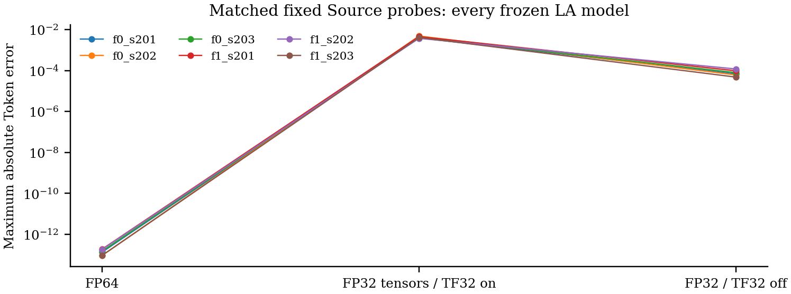
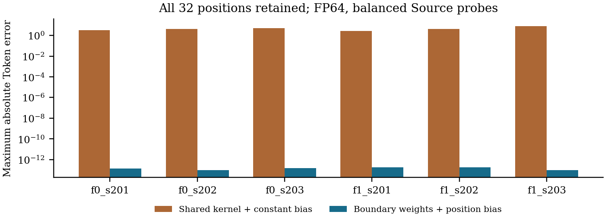

# S28-0：仿射算子与 BN×GELU 机制审计

本轮实际完成零训练审计、预注册和工程 Gate。**新增科学拟合0次，S28-A为0/6，S27-C为0/12，S28-B未启动。** 用户附件明确要求新增训练另行授权。工程 Gate 共7次合成更新，含首次比较器设备错误前的3次和修复后的4次；均未使用RF数据。错误只涉及CPU/CUDA优化器标量的检查方式，模型、优化器及随机流恢复执行代码未改。

## 1. 核心发现与边界

六个冻结 No-GELU（LA/H3）模型均支持有限长度仿射物化：在相同Source均衡探针上，float64最大Token误差 **1.830e-13**，最大logits误差 **1.024e-13**；预定atol=rtol=1e-9，全部通过，预测均不变。普通共享340点卷积在首尾Token不等价，误差被完整保留；加入边界权重与位置偏置后才得到完整算子。

**原生数值运行并未通过等价合同。** FP32张量、cuDNN TF32开启时，完整12000条Source预测的最大logits差为 **0.024471**，有 **1/12000** 个argmax改变，六个模型均未达到原定atol=rtol=1e-4。没有放宽容差、删位置或替换失败结果。随后预先登记的同探针TF32开/关诊断中，关TF32全部通过，最大logits差 **3.147e-05**，预测改变 **0/300**。后者是300包数值诊断，不是全12000包的新验收，也不改变历史训练/评价精度。

这与S23已有的另一类转换精度问题方向一致；S23旧实验没有重命名为本轮结果。转换仅保存到本地，不替换历史模型或成绩。数学函数表示可等价，与给定浮点内核运行逐数值等价，是不同命题。

## 2. 数学定义与全部边界

令 z 为共享CNN前端输出，形状32×8192。四个有限长度卷积算子为C1…C4；前三个推理BN为D_i h+d_i（running统计冻结），则Tokenizer为有限仿射映射：

`W_eff = C4 D3 C3 D2 C2 D1 C1`，偏置由逐层递推得到。C_i本身包含各层stride、padding和有限区间裁切，不能把中间零填充忽略。

核/步长/填充为 `(8,4,2)→(8,4,2)→(8,4,2)→(4,4,0)`；长度 `8192→2048→512→128→32`。合成支持340、stride256、padding42，第一中心127.5；加上共享CNN的11点支持，名义CNN路径支持为350。TrueIB与FFT使其不能解释成端到端物理RF局部支持。

`T(z)[:,t] = b_t + Σ_(c,q) K_t[:,c,q] z[c,256t-42+q]`，输入外按零处理；q=0…339。

- t=1…30 共用K；t=0和31使用显式K_0、K_31，并保留全部32个位置。
- 偏置b_t由原Tokenizer零输入得到；中间30位置相同，首尾可不同。
- 系数通过逐层局部伴随反传、逐层合法区间裁切构造，独立于分类标签；不构造2048×262144的巨大稠密矩阵。
- 该表示存储2091008个系数，作为冻结buffer没有可训练参数；不是参数压缩结论。

**仿射只相对于共享前端输出成立。** 两个共享BN、两个LeakyReLU、TrueIB/幅相/FFT前端以及MHA均保留。No-GELU在训练时的BN依赖batch，不是贯穿训练的固定仿射映射。

## 3. 六组完整误差

|模型|FP64 Token最大差|FP64 logits最大差|原生FP32 logits最大差（2000包）|原生argmax改变|严格FP32探针logits最大差（50包）|
|---|---:|---:|---:|---:|---:|
|LA_f0_s201|1.315e-13|5.418e-14|0.018094|0|2.098e-05|
|LA_f0_s202|9.059e-14|4.619e-14|0.017926|0|2.933e-05|
|LA_f0_s203|1.457e-13|1.024e-13|0.018688|0|2.152e-05|
|LA_f1_s201|1.830e-13|5.862e-14|0.024471|0|3.147e-05|
|LA_f1_s202|1.776e-13|5.973e-14|0.018289|1|2.521e-05|
|LA_f1_s203|9.059e-14|4.530e-14|0.017959|0|2.086e-05|

原生FP32全Source验证每模型2000包；FP64及后续精度诊断使用每RX×TX的首个合法验证包，每模型50包。固定抽样、全部种子、全部位置及失败元素数保留在JSON/CSV。最大相对误差在接近零的位置可能很大，因此同时报告绝对误差、RMS和原定逐元素allclose，不以单一相对误差作结论。

## 4. BN×GELU 预注册：缺失单元未填写

|模型|Tokenizer中间BN|GELU|参数|历史Dev Accuracy（%）|本轮恢复Source Accuracy（%）|
|---|---|---|---:|---:|---:|
|H0|有|有|133690|97.335|98.175|
|LA|有|无|133690|96.583|97.742|
|H2|无|有|133338|96.145|97.142|
|H2_LA（待训练）|无|无|133338|未运行|未运行|

主交互 `(H0−LA)−(H2−H2_LA)` 目前为 **NA**。仅新增H2_LA一种结构，共六次，复用其余18个历史模型；LP六个模型仅作次要对照。两个共享CNN的BN仍保留。GELU无参数，所以新模型与H2的完整初始state相同；所有存活参数与对应H0逐元素相同。移除BN会去掉352个仿射参数，不能把因子效应唯一归因于批统计。

PLAN_A固定原两折、201/202/203、Source160/40、200轮、batch64、AdamW、AWGN和最小Source RX等权CE选模。六模型全部封存后才统一Dev评价。交互按10唯一RX内先平均三个种子，再做10000次RX bootstrap，seed28028；采用双向探索性0.5pp、区间排零、5/6配对同向及两折同向规则。所有四格、反例和Source学习均报告，不做成绩驱动调参、替换种子或声称独立确认。

## 5. S27-C 保持独立且未激活

PLAN_C.original.json与原计划逐字节相同。fold0训练rtl_1/rtl_3/rtl_6/rtl_9，留出b210_1；fold1训练b200_mini_1/pluto_1/rtl_2/rtl_7，留出rtl_5。H0/LP各六个新模型，从S27C-H4x160配对种子重新初始化，不能复用五RX训练权重。每次6400训练/1600源验证、100更新/轮、总20000更新；仅四RX验证选模，12个模型全部封存后才评价留出2000包。

同时报告源域、留出准确率和 `ΔG=(Source−Held)_H0−(Source−Held)_LP`。沿用原规则：两个fold/RX均有held差≥0.5pp、ΔG≤−0.5pp，且至少5/6配对同时方向有利。两台留出RX不是六个独立RX，不做总体显著性/bootstrap。Held-only只有一台RX，跨RX散度按构造为零，Jc不能识别RX不变性，须标为不可识别；不能用epsilon比值制造不变性证据。

本轮数学审计用的是既有五RX模型的合法Source验证，包含这些历史RX；它不产生新C模型或新C留出评价，也不意味着这些接收机在研究历史中从未观察过。C的架构、角色和种子预检已通过，完整科学执行仍须单独激活。

## 6. 研究判断与贡献边界

**可继续研究的候选机制**是多阶段局部卷积的参数化与训练路径；当前仅建立了推理函数表示的数学对象，尚未证明其是性能差异的唯一原因。LA仍保留训练BN，且与LP的分组、自由度、初始化和算力不同；不能从LA−LP的旧2.083pp直接推出纯分层优化因果。

若将有效算子直接作为自由参数，普通32→64、340点稠密卷积仅核与共享偏置就有696384参数，而无BN四层卷积仅86256；若让边界系数独立学习，自由度进一步改变。相同起始函数也不保证参数空间、约束或AdamW状态可比。S28-B须另行审计匹配条件，本轮不设计搜索或拟合。

创新证据矩阵保留S27-B原有全部条目，新增“有精度限定的仿射表示”证据，并明确BN×GELU、RX专项收益、唯一优化归因仍未验证。MHA协同和单一Jw解释均未被重新包装为已证实结论；没有独立新采集或物理RX不变性证明。

## 7. 权限、复现与下一步

24个旧checkpoint的配置、200轮轨迹、最小Source CE选择及48000条原Source预测指标严格恢复；历史权重/config/history哈希保持不变。新增Dev、Confirm、blind数据读取和科学优化均为0。数学代码/容差和数据权限在首次Source读取前提交；精度诊断在看到原失败后单独登记并保留原失败。原始日志、工程更新计数、源数据角色记录和全部数值误差随报告归档。

执行顺序见 registration.json、PLAN_A.json、PLAN_C.original.json。当前launch.py按零预算拒绝训练。用户附件原文：“不要自动启动新实验。先完成零训练审计、预注册和工程 Gate；新增训练须经过明确授权。” 此要求来自本轮用户方案，不是额外推定的批准流程。

建议下一步授权范围明确为A六次，或A六次加原C十二次；两项分别回答BN×GELU交互和RX专项收益，不以一项结果决定是否挑选另一项设计。当前无A/C新成绩，不能提前给出交互或ΔG。
