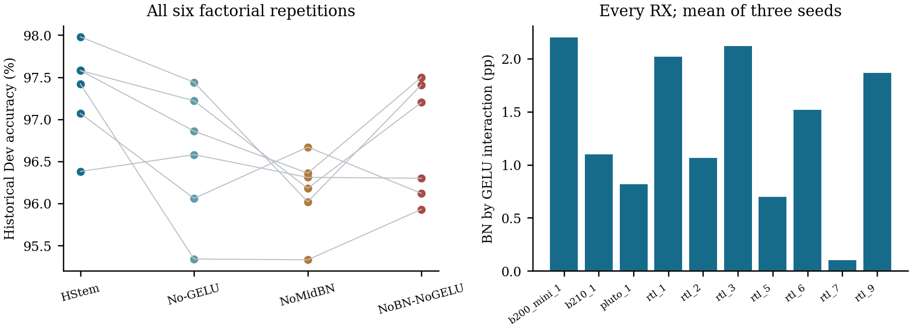
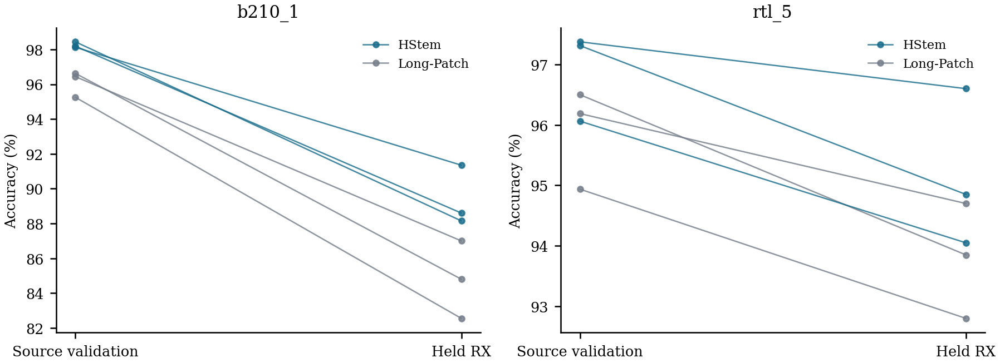
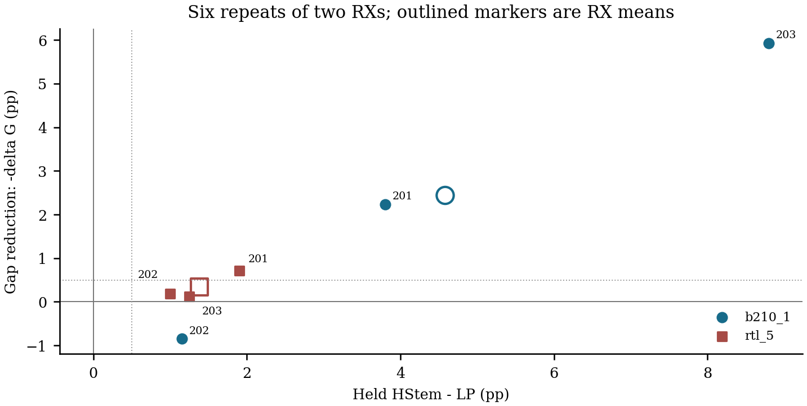
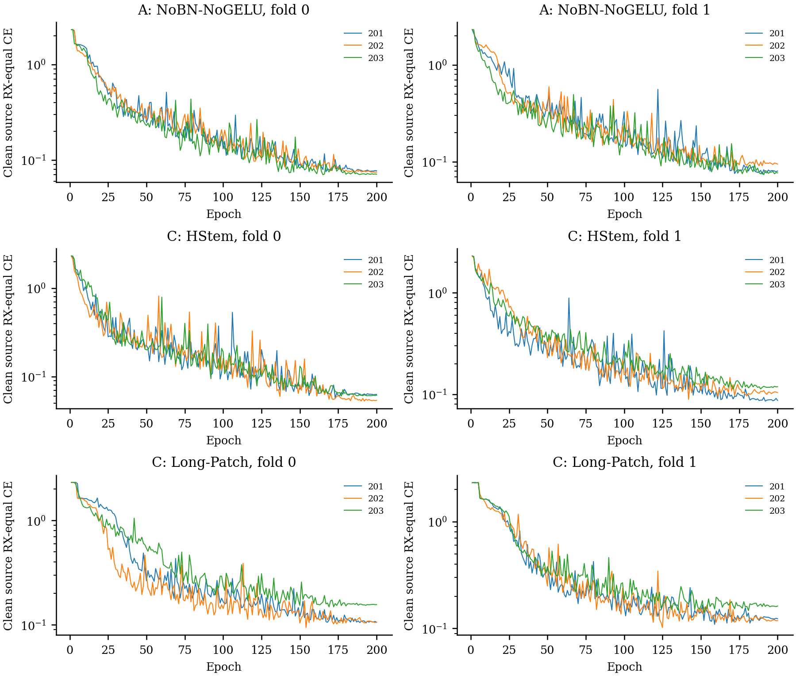

# S28-A 与原 S27-C：18次科学训练完整报告

**已完成A六次、C十二次，每次200轮；另复用24个冻结模型。** 保留的18条轨迹共390000次优化更新，工程合成更新另计为12次。所有目标推理在A、C两组模型均封存并提交后统一执行。C没有依据A结果更改设计或跳过。新增S28-B、IQ-only、ASK Strict-IB与额外训练均为0。

## 1. A：BN×GELU的实际结果

达到预登记的正向交互规则：所选训练程序中，保留中间BN时GELU收益更大。

主交互 `(H0−LA)−(H2−H2_LA)` 为 **+1.350 pp**，条件性RX 95%区间 **[0.930, 1.750]**；与均值同向配对 5/6，两折为 [0.9766666666666695, 1.7233333333333358] pp。规则是双向、幅度至少0.5pp、条件区间排零、至少5/6配对同向、两折同向，全部按原计划判定。负向交互也完整报告，不把正向作为成功的唯一方向。

|模型|参数|Dev Accuracy（%）|六拟合SD（pp）|Macro-F1（%）|最差RX（%）|Source Accuracy（%）|Source CE|
|---|---:|---:|---:|---:|---:|---:|---:|
|HStem|133690|97.335|0.552|97.326|93.667|98.175|0.05902|
|No-GELU|133690|96.583|0.779|96.554|90.383|97.742|0.07693|
|NoMidBN|133338|96.145|0.454|96.135|94.100|97.142|0.09137|
|NoBN-NoGELU|133338|96.743|0.703|96.728|91.633|97.808|0.07473|
|Long-Patch|138346|94.500|1.831|94.423|88.333|96.358|0.10702|

- GELU_with_BN：+0.752 pp；条件区间 [0.197, 1.432]。
- GELU_without_BN：-0.598 pp；条件区间 [-1.150, 0.168]。
- BN_with_GELU：+1.190 pp；条件区间 [0.750, 1.563]。
- BN_without_GELU：-0.160 pp；条件区间 [-0.472, 0.125]。
- H2_LA_minus_LP：+2.243 pp；条件区间 [1.863, 2.588]。

Source主交互为 +1.100 pp。Source已参与checkpoint选择，不能当作独立泛化测试。条件区间按十个唯一RX内先平均三个种子、10000次RX bootstrap、seed28028计算；不包括新种子、新采集、架构选择或多重比较校正后的确证不确定性。

仅Tokenizer中的三个中间BN与三个GELU被干预，前端两BN、两LeakyReLU和MHA保留。移除BN同时移除了352个仿射参数，并改变训练批统计、运行统计及优化；即使交互成立，也不是纯层级参数化的唯一因果证明。LP的分组、自由参数、初始化和算力仍不同。次要比较不能替代主交互，也不能把未达门槛解释成等效。

**具体解释：** 保留中间BN时，GELU的平均收益为+0.752pp；移除中间BN时为−0.598pp，但后者的条件区间包含0，不能单独声称GELU有害。双移除模型仍达到96.743%，比Long-Patch高2.243pp，六组差值均为正。这说明BN/GELU的联合影响值得保留，但它们不能完整解释当前HStem与Long-Patch之间的差异；仍不能把剩余差异唯一归因于层级参数化。四格结果不能被改写为不依赖训练条件的单一模块收益。

## 2. C：整体判别改善与接收机退化分开判断

未达到原C的共同Pilot规则，不能声称已经证明跨接收机退化专门减小。应分别查看留出绝对收益、Source收益及每台RX的退化方向。

|留出RX|HStem−LP Source（pp）|HStem−LP Held（pp）|ΔG（pp）|
|---|---:|---:|---:|
|b210_1|+2.146|+4.583|-2.437|
|rtl_5|+1.042|+1.383|-0.342|

六组均值：Held差 **+2.983 pp**，Source差 **+1.594 pp**，`ΔG=ΔSource−ΔHeld` 为 **-1.390 pp**。同时有利方向（Held差>0且ΔG<0）为 5/6；原规则还要求两台RX均满足Held差≥0.5pp、ΔG≤−0.5pp。两种要求共同判断，不能只看较小gap而忽略留出绝对准确率。

|折|种子|HStem Source（%）|HStem Held（%）|LP Source（%）|LP Held（%）|Held差（pp）|ΔG（pp）|
|---:|---:|---:|---:|---:|---:|---:|---:|
|0|201|98.188|88.600|96.625|84.800|+3.800|-2.237|
|0|202|98.438|88.150|96.438|87.000|+1.150|+0.850|
|0|203|98.125|91.350|95.250|82.550|+8.800|-5.925|
|1|201|97.375|96.600|96.188|94.700|+1.900|-0.713|
|1|202|97.312|94.850|96.500|93.850|+1.000|-0.188|
|1|203|96.062|94.050|94.937|92.800|+1.250|-0.125|

**逐RX判决：** b210_1：Held差+4.583pp、Source差+2.146pp、ΔG-2.437pp；达到原单RX均值双门槛。 rtl_5：Held差+1.383pp、Source差+1.042pp、ΔG-0.342pp；未达到原单RX均值双门槛。

**保留的反例：** fold0/seed202的Held准确率仍提高1.150pp，但Source提高2.000pp，因而ΔG为+0.850pp，泛化损失反而扩大。rtl_5三种子均为有利方向，但均值缩减0.342pp不足预设0.5pp；不能在看到结果后降低门槛，也不把未达门槛解释成完全没有改善。两台RX的Held均值分别为HStem/LP 89.367/84.783%和95.167/93.783%，绝对难度差异也应保留。

Source Accuracy接近上限可能扭曲差距，Source与Held样本数也不同；两者及逐TX混淆均完整报告。两台固定历史RX不能变成六台独立RX，六组SD只描述训练重复，不做RX总体显著性或bootstrap。若Held更好而差距没有稳定变小，结论应收窄为整体TX判别更强；若两RX方向相反，须报告接收条件异质性。

## 3. 固定层几何与类别错误

C固定提取Tokenizer均值、后端前均值和最终分类器输入三种64维特征，先池化再逐包L2。四SourceRX验证每TX×RX40包，共1600包；留出几何仅使用原固定最后40包/TX，共400包，Held分类仍用全部2000包。全部72组层记录、72000个特征向量保留，不更换层、归一化或投影。

完整B_TX、D_RX|TX、W、Jw和Source Jc见C_geometry.csv。Held-only仅一台RX，D按构造为0，Jc不识别接收机不变性，显示NA并保留代数正则化比值；不把epsilon产生的大比值当作机制证据。Source已经用于选模，且Source/Held的RX数不同，几何只作描述。最终Jw不能作为跨RX性能的充分解释，S27-B反例仍有效。

这里B_TX是TX中心相对全局中心的均方散布，D_RX|TX是TX×RX中心相对同TX中心的均方散布，W是包相对所在TX×RX中心的均方散布，均按固定平衡单元取平均。沿用S25定义：`Jc=B_TX/(D_RX|TX+1e-12)`；`Jw=B_TX/(D_RX|TX+W+1e-12)`，Jw分母包含接收机中心差和单元内散布，不能误写成仅W。

逐RX/TX召回、混淆矩阵、CE与真实类margin见A_rx_tx.csv、C_rx_tx.csv及原始聚合JSON。所有困难TX、接收机和种子均保留；不通过删接收机或失败重复获得更好均值。

三种子均值如下，六个层×折组合全部展示；Jc只在四SourceRX上定义，Held仅展示Jw。

|折|层|Source Jc HStem|Source Jc LP|Source Jw HStem|Source Jw LP|Held Jw HStem|Held Jw LP|
|---:|---|---:|---:|---:|---:|---:|---:|
|0|tokens|46.244|10.585|1.414|0.220|1.607|0.486|
|0|pre_backend|104.697|83.685|4.525|3.229|5.206|4.122|
|0|final|68.179|57.593|6.712|4.901|6.455|4.772|
|1|tokens|8.923|9.312|0.589|0.355|0.729|0.383|
|1|pre_backend|21.926|27.113|1.573|2.127|1.872|2.505|
|1|final|29.250|26.619|4.573|4.410|6.296|6.054|

**层级反例：** fold1的pre_backend层，HStem的Source Jc、Source Jw和Held Jw均低于LP，尽管其Held准确率均值更高；同折Tokenizer的Source Jc也略低。最终Jw均值在两折均较高，也不能抹去前端反例或单独充当跨RX机制的充分解释。上述比值仅描述固定坐标及样本的几何，不是互信息或物理不变性。

## 4. 训练配对、成本与完整性

基线de7d010；执行激活及科学适配器在首次RF读取前提交并推送。A沿用P-H5x160种子、8000/2000包、125更新/轮；C使用S27C-H4x160新种子、6400/1600包、100更新/轮，从头初始化H0/LP。所有组200轮、batch64、原AdamW/warmup/cosine/AWGN及Source RX等权CE选模。初始化、首个排列与噪声流、checkpoint选择和完整轨迹均经独立核验。

全部42模型统一产生324000条目标预测、79200条Source预测。24个旧模型的A Dev logits逐元素恢复；全部新模型的Source指标及最优CE恢复，旧权重/config/history哈希不变。C没有加载五RX权重；Source角色从缓存打开前就排除其留出RX。两个阶段的设计不互相适应，但它们共享数据研发历史，不声称是统计独立的数据集。

18个新模型均已封存后，首次统一评价的保存函数发生参数重名：文件名参数rx与待保存的接收机数组rx冲突。错误发生在首个Source预测后、任何Dev/Held读取之前。原错误日志和全部冻结代码、模型保持原样；独立提交的IO-only包装器只更正保存参数名，通过合成保存检查后继续同一已封存队列。没有重训、增加优化步骤或改变评价公式；TECHNICAL_REPAIR_001.json与REPAIR_RESULT_001.json保留完整证据。

每轮原子断点含当前/最优权重、优化器、所有随机状态和历史；如有暂停或工程恢复，其原始日志和快照记录保留，390000指最终保留的完整轨迹，不代表可能被丢弃的部分轮物理执行。多进程wall时间会重叠，不能把拟合wall之和称作独占GPU小时。18次全部最佳轮次、Source CE、耗时与参数见all_new_fits.csv。

## 5. S28-0 数值限定与科研解释

S28-0六个冻结No-GELU Tokenizer在float64、显式首尾边界修正后具有有限仿射表示；原生TF32仍有1/12000个预测变化并未通过既定容差。关TF32的300包诊断通过，不覆盖原12000包失败，不替换历史模型或成绩。本轮使用原生科学模型与原精度训练，并未改用物化算子。

A回答BN/GELU对完整训练程序的联合影响，C回答两台固定历史留出RX上是否出现较小退化。这些结果不自动证明纯层级因果、物理接收机不变性、未知TX拒识、安全攻击防御或独立新采集泛化。创新证据矩阵更新A/C已完成条目，其余历史机制边界保留，不直接改写TIFS贡献。

## 6. 下一步建议与停止点

本阶段停止自动训练。先结合A的四格与带符号交互、C每RX的Source/Held/ΔG以及反例确定论文允许的措辞。C若未支持稳定较小退化，优先定位为低预算下更强的轻量TX判别学习，避免强称RX抑制。即使A/C规则满足，也仍只支持所选程序和这两台历史RX。

若未来要研究分层参数化与直接参数化，须先审计相同起始函数、边界约束、自由参数量、初始化和AdamW状态；S28-0表明函数表示相同不等于优化路径相同。S28-B没有授权预算，本轮不搜索或启动。没有新的独立采集，不宣称独立盲测已经完成。
