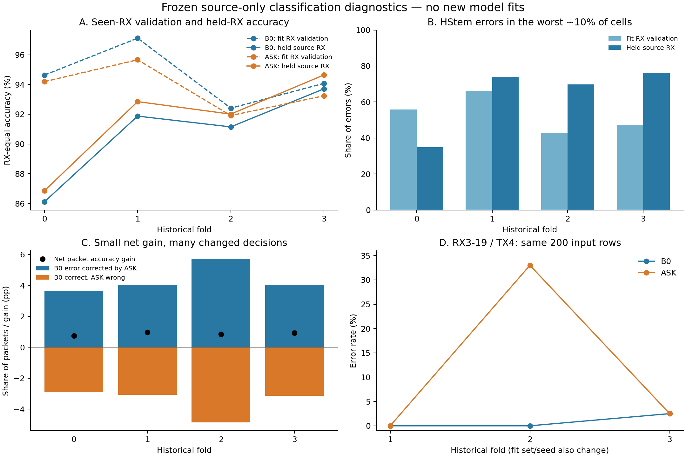
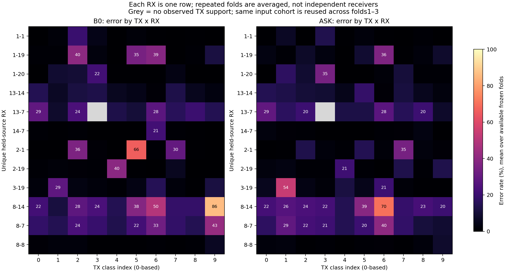

# 冻结 HStem / ASKNet：分类功能失效诊断

日期：2026-11-11。基于 `7ae38a7`；研究分支 `research/classification-failure-diagnostics`。诊断代码、数据白名单及描述性规则先封存于 **`0a968be`**，随后读取旧预测。

状态：**DIAGNOSTIC_COMPLETE_MECHANISM_UNRESOLVED**。本轮完成只读功能诊断，没有训练新模型或执行模型 forward，没有打开新 IQ、checkpoint 或特征缓存，没有进入路线 I/II/III 的算法试验。

## 研究结论

HStem 的失败确实集中在特定 TX×RX×Day 组合，部分组合可由另一个冻结强模型大幅恢复；同时出现了随 RX/day 条件变化的错误统计和随训练实例变化的局部混淆。**当前不能把原因唯一归结为‘局部扰动下边界脆弱’，尚不足以启动路线 I 的鲁棒 Margin 损失训练。**

下一步应把可信变换族验证与一个同预算的既有组风险训练对照分别设计。路线 II 的环境混合/多原型解释缺少 embedding 和留 TX/day 可预测性证据，继续保留为条件候选。本轮没有新命名算法，也没有修改 S17–S20 的历史 STOP。

## G0：本轮实际使用的信息

| fold | train 包 | fit-validation 包 | held-source 包 | fit 缺失 TX×RX×Day cell | 非空 train cell 支持 |
|---|---:|---:|---:|---:|---:|
| 0 | 24267 | 10401 | 11800 | 13 / 360 | 49–80 |
| 1 | 24127 | 10341 | 12000 | 15 / 360 | 50–81 |
| 2 | 24267 | 10401 | 12000 | 13 / 360 | 49–80 |
| 3 | 24640 | 10560 | 12000 | 8 / 360 | 55–81 |

每折为 24 个 source RX 中 18 个 fit、6 个 held，另外 8 个该折 target RX 禁止访问。只使用日期1–2。held 组共 **12 个唯一 RX、23,800 条按同 RX 输入血缘去重的记录**，四折合计 47,800 条 held 预测/模型；folds1–3 重复同 6 个 RX、同一批 12,000 输入记录，不能将它们当成新增接收机或新包。该去重不声称跨 RX 是物理不同的发射事件，也不为其建立包配对。

读取的是 16 个封存预测文件和 20 个 source 标签/索引文件；独立 QA 再读 16 个登记预测文件。数据边界、每路径 SHA 和顺序依据见 [G0_PROTOCOL](G0_PROTOCOL.json)、[INPUT_REGISTRY](INPUT_REGISTRY.json)、[ACCESS_LOG](ACCESS_LOG.json) 与 [QA_ACCESS_LOG](QA_ACCESS_LOG.json)。旧 cache 没有独立包 ID；同模型输入的配对依据是确定性索引/顺序及匹配的源 cell 哈希，详见 [D4 审计](D4_FRONTEND_AUDIT.zh-CN.md)。不同 RX 包从未按数组下标配对。

## D1：错误集中，但不能简单归因于少样本

| HStem fold | fit 验证：最高约10%组的错误份额 | held：最高约10%组的错误份额 | held 这些组的包份额 | train 支持数 vs 验证错误 Spearman |
|---|---:|---:|---:|---:|
| 0 | 55.79% | 34.91% | 10.17% | 0.063 |
| 1 | 66.22% | 73.95% | 10.00% | -0.020 |
| 2 | 43.00% | 69.77% | 10.00% | 0.043 |
| 3 | 46.99% | 76.03% | 10.00% | -0.065 |

最高风险约10%的观察组承载远超样本份额的错误；held 非空 cell 都有 100 包，只有 fold0 缺失 2/120 cell。训练支持与验证错误的相关性接近零，不能直接把组风险差异解释为采样数量不足。此处只有训练标签支持和训练 RX 验证风险，**没有训练集逐包预测/梯度，所以没有测得实际训练组损失的因果机制**。

每折 HStem 最差的一个观察 cell（探索性选择，均 n=100）：

| fold | TX索引 | RX | Day | HStem 错误数 | ASK 错误数 | HStem错误被ASK纠正 | HStem正确被ASK破坏 |
|---|---:|---|---:|---:|---:|---:|---:|
| 0 | 9 | 8-14 | 2 | 88 | 22 | 66 | 0 |
| 1 | 5 | 2-1 | 2 | 100 | 67 | 33 | 0 |
| 2 | 2 | 2-1 | 2 | 96 | 20 | 77 | 1 |
| 3 | 4 | 2-19 | 1 | 96 | 2 | 95 | 1 |

这些结果说明部分 HStem 失败包可被另一个既有分类器判对，不能将 HStem 失败直接解释为观测不可辨识。它们不证明模型利用了纯 TX 硬件信息，也没有证明其余包在信息论上可分或不可分。ASK 仍会制造其他局部错误，不能用挑出的成功 cell 宣称整体优越。

## D2：观察到裕量变化，尚未观察扰动鲁棒性

`margin = true logit − largest wrong logit`。同时保存最难负类计数、预测混淆、置信度、熵及 5/25/50/75/95% 分位数。原始 Margin 受得分尺度影响，不能直接比较两模型。normalized margin 除以该包 10 类 logits 的标准差，对公共平移/正尺度缩放不变；它依然不是物理边界距离或认证半径。

| HStem fold | fit RX Accuracy % | held RX Accuracy % | fit / held RX等权 normalized margin | 共同TX/day分层 Margin差 held−fit | held 错误中 confidence≥0.9 的比例 |
|---|---:|---:|---|---:|---:|
| 0 | 94.63 | 86.11 | 1.877 / 1.425 | -0.436 | 11.60% |
| 1 | 97.12 | 91.88 | 2.119 / 1.804 | -0.311 | 42.67% |
| 2 | 92.41 | 91.15 | 1.625 / 1.517 | -0.097 | 36.53% |
| 3 | 94.08 | 93.71 | 2.007 / 1.915 | -0.092 | 17.75% |

HStem 的共同 TX/day 分层 Margin 四折均下降；但错误并非全在零附近。fold1/TX5/RX2-1/day2 的 100 个错误中有 69 个原 confidence≥0.9，Margin 中位数 −6.9466。未做概率校准，confidence 不能当作真实正确概率。

一个反例是 ASK：其分层 normalized margin 也四折下降，但 fold2/3 的 held Accuracy 高于 fit-validation，且 CE 更低。这说明平均 Margin 不能单独决定未知 RX 分类收益。干净 logits 更不能给出局部 `T_eta x` 的最坏响应；没有可信变换族时，不把这项诊断叫作已验证的‘边界脆弱’机制。fit-validation 曾参与选模，角色比较也不是同包或随机实验。

## D3：净增益小，错误集合变化大

| held fold | HStem错→ASK对 | HStem对→ASK错 | 两者都错 | 错误Jaccard | ASK−B0 RX等权 pp | 标签oracle上界 % |
|---|---:|---:|---:|---:|---:|---:|
| 0 | 430 | 341 | 1200 | 0.609 | 0.7426 | 89.74 |
| 1 | 485 | 368 | 490 | 0.365 | 0.9750 | 95.92 |
| 2 | 686 | 583 | 376 | 0.229 | 0.8583 | 96.87 |
| 3 | 487 | 375 | 268 | 0.237 | 0.9333 | 97.77 |

例如 fold2：ASK 纠正 686 个 HStem 错误，同时把 583 个 HStem 正确包变错，净增 103 个正确包。两模型只共同错 376 个包。oracle 使用真实标签选择正确模型，只是错误互补的诊断上界；本轮没有设计或验证集成器，也不将它作为可部署性能。原始包等权净差和 RX 等权差可能不同，表中明确使用后者。

S20 已定位的最差配对 RX3-19（fold2，−8.05 pp）可进一步拆成：

| TX索引 | Day | n | HStem错 | ASK错 | ASK最主要错误类别及计数 |
|---|---:|---:|---:|---:|---|
| 1 | 1 | 100 | 15 | 34 | TX2：14 |
| 1 | 2 | 100 | 22 | 85 | TX2：67 |
| 4 | 1 | 100 | 0 | 52 | TX5：52 |
| 4 | 2 | 100 | 0 | 14 | TX5：14 |

TX1 的主要增错在 day2；TX4 在 day1 的 52 个错误全预测成 TX5。这里 TX 索引从0开始，TX1/4 对应历史 tx_list 的 `11-1` / `17-11`。这些是探索性定位，不是频带、Koopman 或某项训练设置的因果归因。

同一 RX3-19、同一批 200 包/TX，在 folds1–3 的错误数为：

| TX | 模型 | fold1 | fold2 | fold3 | 三折均错的包数 |
|---:|---|---:|---:|---:|---:|
| 1 | B0 | 65 | 37 | 71 | 19 |
| 1 | ASK | 112 | 119 | 94 | 66 |
| 4 | B0 | 0 | 0 | 5 | 0 |
| 4 | ASK | 0 | 66 | 5 | 0 |

TX1 的 ASK 困难反复出现，TX4 的严重失败主要出现在 fold2；因此同一接收机内也至少存在不同的功能模式。相同输入不变而模型输出变化，说明不能把这些错误全部归为观测不可辨识。各折 fit RX、data seed/split 和训练轨迹共同改变；它不是纯 seed 消融，也不能用 folds1–3 当独立确认。

## 不确定性、解释范围与下一步

按同 RX 跨 fold 先平均，12 个唯一 RX 的 ASK−B0 均值为 **0.8324 pp**。本次预先固定 bootstrap seed21111、5000次的条件区间为 **[-0.7056, 2.5727] pp**，仍跨零。S20 原区间 [−0.7681,+2.6029] pp（seed20101）保持原样；有限 Monte Carlo 抽样差异不是新科学证据。区间不覆盖共享训练集、单 macro-seed、模型选择和反复探索的不确定性，不能宣布等价或协议无效。

D4 确认当前是未均衡版本、每 TX×RX×Day 前100包及原前端路径；没有核验本地 EQ/non-EQ 逐包映射，也没有证明任何归一化是失效原因，见 [完整前端审计](D4_FRONTEND_AUDIT.zh-CN.md)。

三个竞争解释的支持、反例、与 S17/S18/S19 的实质区别和最小证伪实验见 [HYPOTHESES.zh-CN.md](HYPOTHESES.zh-CN.md)。目前的具体取舍：

1. 路线 I：暂缓算法训练预注册。先补一个可信、TX 判别安全且对应真实变化的受限变换族；干净 Margin 下降不能代替这一步。
2. 路线 III：把同骨干、同预算的强 ERM / 一个既有 TX×RX 风险目标列为必要控制设计，尚未启动；高风险集中不自动证明 GroupDRO/CVaR 有效。
3. 路线 II：缺少 feature 条件结构和跨 TX/day 预测证据，不实现多原型或边缘化头。

新训练、IQ 或新输入版本访问均需下一份具体登记/预注册。本轮不重新运行相位 FIR、静态 RX 子空间、频带 Teacher，不用历史 held 上的定向修复宣称新泛化。现有证据也没有检验统一 WiSig/LoRa 机制。

## 复核与归档

7 项合成检查通过；独立 float64 程序重算了全部16份旧预测，核对 3840 个 TX×RX×Day 组、1920 个模型配对组，精确重现 192 个已归档 RX 混淆矩阵。见 [QA_REPORT](QA_REPORT.json)。cell 的 Wilson 区间假设包独立，只作描述，不能代替 RX 聚类不确定性；Macro-F1 保留全部10类，缺失 cell 的指标为 null。

- [总体与分层统计](SUMMARY.json)、[完整组表目录](groups/)、[模型配对表目录](pairs/)、[同输入跨fold](REPEATED_INPUT_FOLDS.json)。
- [决定](DECISION.json)、[执行范围](ANALYSIS_COMPLETE.json)、[封存清单](MANIFEST.json)。
- `python -m unittest discover -s research/classification_failure_diagnostics -p 'test_*.py' -v`：仅合成检查。
- `python research/classification_failure_diagnostics/verify.py`：只重读白名单旧预测做数值复核；会更新本分支的派生 QA 报告。
- `python research/classification_failure_diagnostics/report.py`：只读取派生 JSON 重生成报告/图表，不打开科学数组。

原始执行 `diagnose.py` 会拒绝覆盖已有完成记录；不得删除记录来追逐结果。跨机器复现需要 INPUT_REGISTRY 所列本地旧预测与标签文件及匹配 SHA。原始 IQ、权重、逐包预测、外部作者源码均未上传。参数、时延和显存没有重测；模型未改，成本只引用 [S20 原测量](../../20-asknet-source-comparison/COSTS_AND_STRUCTURE.json)。
