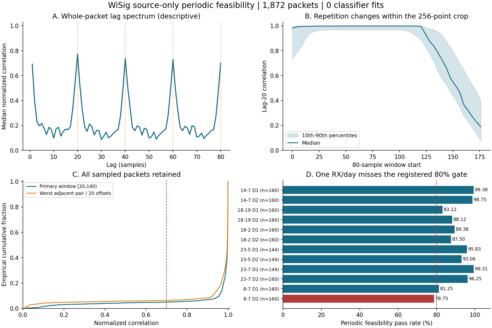

# WiSig 周期 HStem：有界源包核验结果

**20点重复结构得到支持；预注册的固定窗口方案未通过局部门，三结构训练未启动。** 这不是二维HStem识别性能的负结果，也不能解释成方向A已被否定。

检查前提交 `8edb451`，沿用C的源域白名单与原train_ids，只检查两视图共同fit的6台RX、日期1–2，共1,872包；每实际存在RX×TX×day抽16包，共117格。3个缺失格原样报告。checkpoint_val/source_selection没有IQ数值读取，historical held6/target8/日期3–4没有访问。完整源IQ文件为核对SHA读取了原始字节，只有抽中行被复制并作数值计算；不把哈希读取描述成只接触抽中包的文件字节。

| 预注册检查 | 结果 |
|---|---:|
| 总体通过率，要求≥90% | 1699/1872 = 90.7585% |
| 最差RX×day通过率，要求≥80% | 8-7，D2：126/160 = 78.75%，未通过 |
| 主要窗口[20,140) lag20相关，中位数 / p10 | 0.997244 / 0.956786 |
| 全部窗口起点下最差相邻周期相关，中位数 / p10 | 0.996017 / 0.925237 |
| 尾段[160,256) lag20相关中位数 | 0.332254 |
| 整包[0,256) lag20相关中位数 | 0.773073 |
| 分类器fit / TX判别或RX泛化评分 | 0 / 未执行 |

## 证据怎样解释

采样率25 Msps与L-STF的0.8 μs周期给出20点候选。局部窗口的高相关及整包lag20/40/60/80峰支持重复波形确实存在；滑窗结果又显示后段重复性下降，因此把全部256点直接当成同质短符号矩阵缺少支持。相关下降本身不精确定位L-STF边界，也不能区分边界、检测误差、干扰、信噪比或硬件响应的贡献。

主要候选是[20,140)六行二十列；为避免一次整体相关掩盖局部失配，门要求全部20种起点偏移下的相邻行相关≥0.7，并要求lag20相对lag19/21的优势≥0.05。后一个条件防止把单音或很平滑的波形误当成20点特有周期。它检验周期证据是否足够明确，不等同于判断包是否为有效Wi-Fi。

相邻周期相关门有117包未过，周期区分度门有148包未过，重叠92包，合计173包；未删除任何失败包。

局部门仅在8-7的D2未过：126包通过，80%门要求128包，相差2包。**这是有限源样本上的工程停止条件，不能把1.25个百分点的差距解释成统计上证实固定窗口不可用，更不能推出周期建模不可能有效。** 高相关也不识别绝对短符号起点；p列目前是包相对坐标，不保证跨包处于同一物理相位。

## 本轮决定

机器判定：`STOP_FIXED_PERIODIC_WINDOW_NOT_RELIABLE`。遵守检查前冻结的停止规则，不在看到数据后改用[40,160)、放宽门槛、剔除失败包、追加样本或训练种子。本轮没有实现并训练二维候选，也没有将lag20相位通道重新包装成新方法。

三结构竞争保留为条件式方案：频域HStem+MHA、参数受控的一维时域HStem、周期二维HStem；训练之前仍须独立冻结输入信息、整包保留方式、参数容差与共同分类器初始化。当前可行性结果不支持跳过这一步。已有EMA平均收益仍需在之后的独立强基线比较中保留，不把普通ERM的结构竞争当作超过最强标准配方的证明。

要继续这一物理假设，缺的是可信边界或能显式处理起点不确定性的表示及公平对照，而不是另一个Loss。那将是新的、独立预注册的假设；本轮不自动添加自适应对齐、有效包筛选、均值/残差分支或其他补救结构。正式CRD与新RX确认权限保持原资格限制。

## 可复核材料

合成测试9项通过；`verify.py`从逐包派生量和原始元数据独立重算抽样、决策及每个分组，159项核验通过；核验不读取IQ。输出PNG及SVG已生成。数值证据、源路径、时间与SHA保留如下：

- [检查前登记](AUDIT_REGISTRATION.json) 与 [方法和停止规则](README.zh-CN.md)。
- [全部逐包派生量](PACKET_METRICS.npz)、[结果JSON](AUDIT_RESULT.json) 与 [访问记录](ACCESS_LOG.json)。
- [复核结果](VERIFICATION.json)、[复核代码](verify.py) 与 [图表SVG](FEASIBILITY.svg)。

外部物理依据：[WiSig原论文 §III–IV](https://arxiv.org/html/2112.15363)、[MathWorks L-STF文档](https://www.mathworks.com/help/wlan/ref/wlanlstf.html)。没有本轮新增的目标域性能、LoRa迁移结果或成功机制声明。
