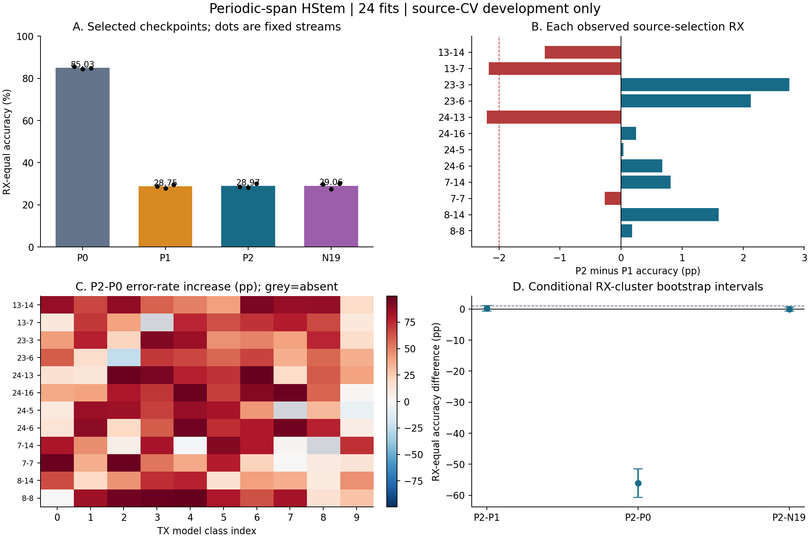

# 周期跨度HStem：完整源域竞争结果

**24/24科学拟合完成，判定：`STOP_NO_PERIODIC_SPAN_PROMOTION`。** 固定窗口方案的STOP保持不变；本结果是重复使用合法源角色的开发竞争，不是正式CRD或独立新RX确认。

## 主要端点：checkpoint_val CE选择的checkpoint

| 臂 | RX等权Accuracy | Macro-F1 | CE | 最差绝对RX Accuracy | 参数 |
|---|---:|---:|---:|---:|---:|
| P0 | 85.0332% | 81.3311% | 0.516880 | 8-14: 71.083% | 82,426 |
| P1 | 28.7539% | 25.5531% | 4.163755 | 13-14: 19.567% | 84,394 |
| P2 | 28.9667% | 25.8091% | 4.118378 | 13-14: 18.317% | 83,786 |
| N19 | 29.0587% | 25.6276% | 4.167555 | 13-14: 18.050% | 83,786 |

**三种纯时域方案均未能保持原频域路径的跨RX表现。** 本实现保留了原局部stem、32-token接口与分类器，在P1/P2/N19中把前端替换为纯时域视图；没有保留P0频域路径再额外融合周期分支。因此P2对P0的巨大跌幅不能单独归因于dilation20。

| 臂 | 训练RX内部checkpoint_val Accuracy | 留出RX source_selection Accuracy |
|---|---:|---:|
| P0 | 91.9606% | 85.0332% |
| P1 | 93.2874% | 28.7539% |
| P2 | 93.2366% | 28.9667% |
| N19 | 93.2632% | 29.0587% |

这个差距由已经冻结的selected端点预测作描述性计算，没有新增IQ读取、拟合或选型。它显示本配方下训练RX内部的高识别率没有转化为留出RX表现；尚不能据此断言信道、CFO、BN或RX硬件中的哪一项是原因。P2−P1仍是同一时域输入下的直接增量检验：微小平均差、跨零区间和局部风险均不支持本候选晋级。

P0为原频域骨干；P1为普通41抽头时域分支；P2为时域dilation20；N19为固定dilation19负对照。P1与P2卷积跨度相同，P1多608参数（0.726%），并非严格等参数或等FLOPs。原骨干公共初态、分支公共层、实际包键顺序与预算均已复核；P2/N19初始全部权重相同。

| 比较 | Accuracy差 / pp | RX条件95%区间 / pp | 最差配对RX差 / pp | 最大受支持TX×RX错误率增加 / pp |
|---|---:|---|---:|---:|
| P2-P1 | +0.2127 | [-0.6356, +1.0479] | -2.2000 | +12.3333 |
| P2-P0 | -56.0665 | [-60.6510, -51.4307] | -67.6833 | +99.5000 |
| P2-N19 | -0.0920 | [-0.6920, +0.5607] | -1.8667 | +10.5000 |

## 冻结门槛与解释

- P2-P1：未通过；失败项：mean_accuracy_at_least_1pp, paired_rx_interval_lower_above_zero, both_views_positive, worst_paired_rx_at_least_minus_2pp, supported_tx_rx_risk_increase_at_most_5pp。
  最大受支持局部风险：RX 13-7、TX类索引2、每流200包，平均错误率增加12.3333pp；全部117个受支持组均参与门槛，不按三流相加制造支持量。
- P2-P0：未通过；失败项：mean_accuracy_at_least_1pp, paired_rx_interval_lower_above_zero, both_views_positive, at_least_two_streams_positive, worst_paired_rx_at_least_minus_2pp, supported_tx_rx_risk_increase_at_most_5pp。
  最大受支持局部风险：RX 8-8、TX类索引4、每流200包，平均错误率增加99.5000pp；全部117个受支持组均参与门槛，不按三流相加制造支持量。

20点相对19点特异性条件：{"accuracy_positive": false, "CE_improves": true, "both_views_positive": false}。N19不参与调参或候选选型。

本候选未获得继续资格，依事前规则停止；不追加seed、跨度、EMA、GroupDRO或新Loss。失败不能推断周期结构不含TX信息，也不能把本轮时间前端、分支宽度、门控与优化共同作用分解成已证实的硬件机制。

P2对P1是受控的同时间输入比较；P2对P0同时改变前端坐标和分支，不能视为纯粹的周期连接因果效应。共同RMS归一化和时域相位乘积不代表TX/RX分离。边界mask只保证数组索引有效，不保证跨区间抽头来自同一训练字段。N19的前置局部stem使19与20跨度的有效感受野重叠，因此它是邻近跨度对照，不是严格消除周期信息的干预；特异性条件通过或失败都不能独自证明TX物理机制。

## 预定辅助端点，未用于择优

| 端点 | P0 Accuracy | P1 Accuracy | P2 Accuracy | N19 Accuracy |
|---|---:|---:|---:|---:|
| selected | 85.0332% | 28.7539% | 28.9667% | 29.0587% |
| epoch10 | 85.5628% | 26.7783% | 26.6842% | 25.6397% |
| final40 | 86.2242% | 28.7426% | 29.1347% | 29.0349% |

## 验证、成本与复现

11项CPU测试通过，真实训练循环的4条合成CUDA轨迹/24次更新通过。首次工程夹具在Windows使用int32标签失败，已在科学IQ读取前修正并保留失败目录；科学拟合24次、无失败重试。独立QA 5,258项通过，复核全部72份端点预测、逐组风险、bootstrap、初态、40轮顺序及全部artifact摘要；QA没有读取IQ。

科学预算共960 epoch、121,920更新。各方法训练/验证与完整wall time如下；工程验收不并入科学fit数。

| 臂 | 训练秒 | 验证秒 | 6次fit总wall秒 | batch1 p50延迟/ms | batch128 p50延迟/ms |
|---|---:|---:|---:|---:|---:|
| P0 | 306.1 | 41.3 | 363.2 | 2.4951 | 2.5647 |
| P1 | 324.0 | 37.3 | 380.4 | 2.3648 | 2.4296 |
| P2 | 643.1 | 78.5 | 743.2 | 2.4315 | 6.0503 |
| N19 | 656.4 | 80.8 | 759.8 | 2.3716 | 5.6269 |

延迟使用每臂V0/S0 selected模型、固定合成CUDA驻留输入，含完整RF前端+HStem+MHA；3轮旋转顺序，每轮20次warmup及100次CUDA-event测量，batch1/128。只报告设备计算延迟，不包含磁盘与主机传输，p95和吞吐见LATENCY.json。

原源域分割及三个配对流沿用C，wd=.001由此前公开源开发结果固定；这不是未见开发集上的确认。RX bootstrap只覆盖已观察12个源留出RX，三流先平均，不把包或模型当独立样本，多比较未校正。历史held6、target8、日期3–4、Full新RX以及LoRa/ManySig均未访问。

- [冻结协议](PREREGISTRATION.zh-CN.md)、[机器登记](REGISTRATION.json)、[24次作业](JOBS.json)。
- [全部端点汇总](SUMMARY.json)、[完整分组与配对分析](ANALYSIS.json.gz)、[独立复核](INDEPENDENT_QA.json)。
- [72份源选择预测归档](SOURCE_PREDICTIONS.zip)、[训练封存](TRAINING_SEAL.json)、[实际初态与序列证据](RUN_EVIDENCE.json)。
- [训练RX内部与留出RX的描述性差距](GENERALIZATION_GAP.json)、[六次P0基线轨迹复现](BASELINE_REPLAY.json)。
- [复核器工程失败记录](QA_ATTEMPTS.json)：首次在保存结果时遇到NumPy布尔值序列化问题，仅修复输出类型；模型、预测、评分、门槛及科学fit数均未改变。
- [成本](COSTS.json)、[延迟](LATENCY.json)、[本地全状态归档摘要](ARTIFACT_ARCHIVE.json)。
- [原始执行代码字节包](FROZEN_EXECUTION_BYTES.zip)及[逐文件SHA](EXECUTION_BYTES.json)，保留旧依赖的CRLF与新代码LF，避免Git换行规范化导致运行字节丢失。
- [原固定窗口STOP证据](../periodic_hstem/AUDIT_RESULT.json)，该文件SHA与新登记逐次核对一致。

空洞卷积是已有算子，见[Yu & Koltun](https://arxiv.org/abs/1511.07122)；本轮没有把既有算子、19点对照或源开发增益包装成原创性证明。
