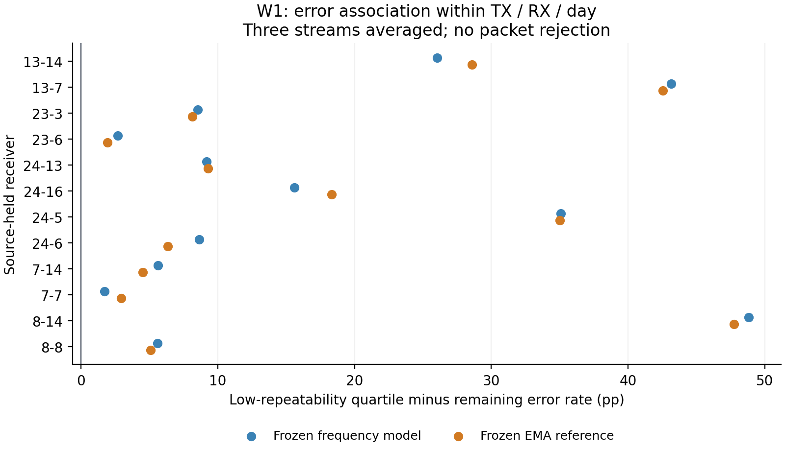

# WiSig质量条件化指纹保留：受控执行

用户2026-11-13要求参考所附方案执行，并根据现实成果独立判断。本分支`exp/wisig-quality-preservation`基于`02537cb`，保留原LoRa及WiSig负面证据，独立执行W1→有条件W2，不修改旧阶段门槛，也不访问目标RX或日期3–4。

## 阅读顺序

1. [W1预注册](PREREGISTRATION.zh-CN.md)及[结果](RESULTS.zh-CN.md)：22,968合法源包，冻结普通频域及EMA预测；TX×RX×Day内控制混杂。EMA低一致性四分位比其余包高17.5332pp错误，RX条件95%区间[9.0440,26.9902]pp、12/12 RX同向。W1通过后直接进入已授权W2。
2. [W2冻结协议](W2_PROTOCOL.zh-CN.md)及[W2登记](W2_REGISTRATION.json)：同容量B1普通门控、B2真实质量门控、N0打乱质量负对照，各2视图×3流，总18新拟合。B0复用六个逐比特重放核验的EMA强基线。
3. [LoRa贡献组织](LORA_CONTRIBUTIONS.zh-CN.md)：一项核心结构贡献、两项支撑证据及投稿边界；本轮新增LoRa训练0。
4. [文献核验](RELATED_WORK_AUDIT.zh-CN.md)：区分出版方/作者核实信息与未读全文的细节，不用跨协议数字宣传领先。

W2终态以`W2_RESULT.json`和`W2_RESULTS.zh-CN.md`为准（全部训练封存并评分后生成）；`W2_LIVE.json`、`W2_PROGRESS.json`只反映运行进度。ATTEMPT文件记录启动时快照，不代替终态。



## 证据、检查与复现

- [W1登记](REGISTRATION.json)绑定原源数组白名单、两视图角色、12份历史预测SHA和代码SHA；首次科学IQ读取前已提交`1e24b3e`。
- W1全部单元/逐RX/反例在`W1_CELLS.csv`、`W1_RECEIVERS.csv`、`W1_COUNTEREXAMPLES.csv`；`W1_QA.json`为独立重算11项通过。
- 六项合成信号检查验证代理的物理基本性质和混杂控制；W2三臂共240个合成优化步、120个epoch，22项工程检查全部通过，详见`W2_ENGINEERING.json`。首次合成夹具的Windows int32标签错误保留在`ENGINEERING_ATTEMPTS.json`，科学拟合不受影响。
- `W2_PREFLIGHT.json`给出六份B0的样本角色、初始主干、EMA验证预测精确重放。`W2_TRAINING_SEAL.json`仅在18条轨迹完整结束后生成，先提交再评分。
- 新权重、优化器/RNG状态、每epoch样本顺序、逐包预测均在本地`artifacts/`，不纳入Git；结果记录逐份SHA。未改动任何历史权重或原缓存。

在本机工作树根目录，以`D:/crossatten/.venv/Scripts/python.exe`运行：

```powershell
& D:/crossatten/.venv/Scripts/python.exe research/quality_preservation/test_quality.py
& D:/crossatten/.venv/Scripts/python.exe research/quality_preservation/verify_results.py
```

科学执行器`run_w1.py`、`w2_execute.py`和`w2_score.py`均设一次性守卫，拒绝覆盖已经存在的科学尝试/结果。复算现有统计使用`verify_results.py`，不重新训练。原始数据需要本地已登记路径，不能只凭报告在无数据机器上复现训练。

## 结论范围

质量代理是固定包相对窗口内的局部重复一致性，不等于物理SNR、完整前导码有效率或TX硬件机制。W1是条件关联；W2才比较算法增益。TX/RX/day分组只用于统计控制，不能拿标签条件下的低四分位作为部署质量阈值。无拒识、无删包，所有包进入分母。

开发RX此前已经反复使用，W1也用其进行机制发现；本轮成绩是条件开发证据，不能恢复全新RX盲测资格。RX型号映射不足，不根据编号猜测B210/N210。低噪声评估采用相对观测功率的名义新增噪声，不能称实际空口SNR。
