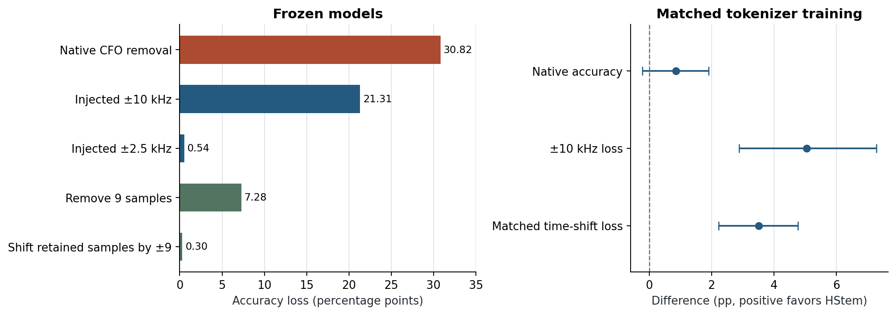

# S29 WiSig 频偏干预与 HStem 结构对照

ManyRx，沿用 C 的 fold2 源域 D1/D2。V0/V1 各留出 6 台接收机，分别包含 11,468 和 11,500 个未均衡 WiSig 包。表中准确率先按 RX 等权，再平均种子和视图。区间按视图分层重抽已观察的 RX，条件于这些历史源接收机和固定权重。外层目标 RX、D3/D4 和 ManySig 未进入本轮。

## 物理诊断

| 读数 | V0 | V1 |
|---|---:|---:|
| fit_train 的可靠校正覆盖 | 46.69% | 51.81% |
| [20,140) lag20 相干性中位数 | 0.9976 | 0.9976 |
| [160,256) lag20 相干性中位数 | 0.3307 | 0.3226 |
| 旧 STF 频带内能量占比中位数 | 96.53% | 96.59% |
| 观测 CFO 的 TX 中位数跨度 | 23.42 kHz | 23.38 kHz |
| 按 TX 中心化后的 RX×day 中位数跨度 | 4.77 kHz | 6.47 kHz |

CFO 分组先对每个至少有 8 个可靠包的 TX×RX×day 单元取中位数，再等权形成 TX 中位数和按 TX 中心化的 RX×day 中位数。V0/V1 分别有 186/175 个达到支持的单元，覆盖 10/9 个 TX。RX×day 剩余量仍可能混合天然偏移、信道和估计误差。频带只作描述，没有把带外成分删除。前段高相关支持 20 样点重复结构，无法标定天然包起点。

| 冻结 A0 干预 | RX 等权准确率变化 | 条件 RX 95% 区间 |
|---|---:|---:|
| ±2.5 kHz 注入 | −0.54 pp | [−0.73, −0.36] |
| ±10 kHz 注入 | −21.31 pp | [−23.01, −19.60] |
| 天然估计 CFO 归零 | −30.82 pp | [−34.14, −27.45] |
| ±9 样点循环移位 | −2.26 pp | [−2.76, −1.76] |
| 减少 9 个边缘样点并补零，保留样点位置 | −7.28 pp | [−8.04, −6.43] |
| 改变相同 247 个保留样点的位置，等量补零 | −0.30 pp | [−0.81, +0.17] |

两视图各三份冻结 A0 的原始预测均与 W4/W5 留出记录完全一致。±10 kHz 注入后用已知注入值反向旋转，两视图逐包正误均恢复，最大 IQ 绝对误差为 4.77e−7。四个注入幅度的锚定增量估计 p99 最大为 0.008 Hz。锚来自同包未注入观测，验证了受控旋转的可逆性。对原包的总 CFO 归零同时改变了天然观测与训练输入分布，因此冻结读数检验现有分类器的依赖，校正后重训的效果仍未知。

原 S29 因子训练在覆盖率门停止，完成 0/16 次。其余三项工程和敏感性启动条件通过。S29-R 在新权重拟合前单独登记原输入结构和受控扰动对照，沿用同一覆盖规则做分布外诊断。

## HStem 与 Long-Patch

| 原始输入训练的结构 | 参数 | RX 等权 Accuracy | RX 等权 Macro-F1 | RX 等权 CE |
|---|---:|---:|---:|---:|
| HStem | 82,426 | 84.46% | 80.61% | 0.5165 |
| Long-Patch | 82,364 | 83.60% | 80.09% | 0.5345 |

| 主读数和两个预定扰动读数 | HStem | Long-Patch | HStem 优势 | 条件 RX 95% 区间 |
|---|---:|---:|---:|---:|
| 原始准确率 | 84.46% | 83.60% | +0.86 pp | [−0.22, +1.91] |
| ±10 kHz 注入下的准确率损失 | 22.61 pp | 27.66 pp | 少掉 5.05 pp | [+2.88, +7.29] |
| 相同 247 样点的 ±9 位移损失 | 0.77 pp | 4.28 pp | 少掉 3.51 pp | [+2.23, +4.77] |



原始准确率差在 V0/V1 分别为 +0.83/+0.89 pp，4 个配对中 3 个为正。最差 RX 两种子平均为 −2.05 pp，所有种子×RX 的最差配对为 −8.30 pp。原始优势未达到事前判定条件。±10 kHz 两视图的损失差为 +5.17/+4.94 pp，3/4 配对支持 HStem，V0 第 0 号种子反向（−4.93 pp）。等量时移损失差为 +4.03/+2.99 pp，4/4 配对支持 HStem。两项扰动通过预定判定。小幅 ±2.5 kHz 损失差为 +0.94 pp。

8 次拟合共 320 轮、40,640 次更新，约 214 秒。选出的轮次为 3–7，按训练 RX 的验证 CE 最小固定。配对训练的编码器和分类头初态、实际样本顺序逐条一致。冻结诊断和新模型留出分别核对了同一批索引。匹配结构共有 32 个 64 维 Token、相同卷积网格与 32 bin 理论跨度，全模型仅相差 62 个参数。边界处理、逐层非线性的位置和参数分配随 Tokenizer 改变。结果支持所测 HStem 组合在受控扰动下更稳健，结构内部的单一原因仍未识别。

## 对 Shen 与 WiSig 的解释

Shen 上的 HStem 优势是在高度对齐且带宽受控的 LoRa 条件下获得的。ManyRx 的同包干预显示，较大的附加频偏能强烈影响判别，HStem 能减轻部分损失。两个架构在直接归零天然 CFO 时分别下降 30.33、29.11 pp。这与历史 S13 的 CFO 归零重训结果方向一致，两次实验使用了不同模型、归零门槛和协议。目前可正面主张层级频谱 Tokenizer 在测试过的频偏和时移干预下保留更多判别性能。跨新接收机或新日期的收益、天然频偏中 TX/RX 来源的分解、以及校正与 Tokenizer 的训练交互仍待检验。[WiSig 官方信号视图说明](https://cores.ee.ucla.edu/wisig/overview/)

## 复算

- [原方案](PROTOCOL.zh-CN.md)、[原输入对照](RAW_CONTROL.zh-CN.md)、[干预实现](physics.py)、[训练入口](raw_control.py)、[汇总实现](summarize.py)。
- [结果与决策](evidence/SUMMARY.json)、[原计划停止记录](evidence/PREFLIGHT.json)、[主实验权重封存](evidence/FIT_SEAL.json)、[留出预测封存](evidence/PREDICTION_SEAL.json)、[逐 RX 指标](evidence/RX_METRICS.csv)、[复算核验](evidence/QA.json)。
- 工作区 `D:/crossatten/.execution-s29` 保留逐包审计、冻结模型预测、8 个所选权重，以及两个视图的多种干预 logits。记录仅包含预测与派生统计，原始 IQ 仍在原 C 缓存中。

```powershell
$python = 'D:/crossatten/.venv/Scripts/python.exe'
& $python research/s29_wisig/summarize.py D:/crossatten/.execution-s29
& $python research/s29_wisig/plot.py D:/crossatten/.execution-s29/SUMMARY.json research/s29_wisig/S29.png
```
