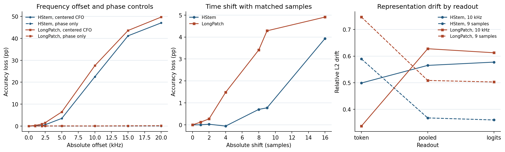

# S30 WiSig 扰动归因与接收机相关频偏

S30 完成 8 份 S29-R 权重的冻结审计，每份模型 129 个推理条件，新增梯度更新 0 次。两套视图合计 12 台历史源域留出 RX、22,968 包。天然 CFO 分析使用原训练侧缓存。正式目标 RX、新日期、ManySig 和 Shen IQ 均未进入本轮。

## A 扰动剂量与相位参照

| 干预或剂量范围 | HStem 掉分 | Long-Patch 掉分 | HStem 少掉的百分点，条件 95% 区间 |
|---|---:|---:|---:|
| 中心锚定 CFO，0–5 kHz 平均损失曲线面积 | 1.10 | 2.26 | 1.16 [0.69, 1.67] |
| 中心锚定 CFO，±2 kHz | 0.30 | 0.93 | 0.63 [0.33, 0.96] |
| 中心锚定 CFO，±5 kHz | 3.48 | 6.43 | 2.96 [1.75, 4.30] |
| 中心锚定 CFO，±10 kHz | 22.53 | 27.59 | 5.06 [2.87, 7.28] |
| 与 ±10 kHz 对应的单独整体相位旋转 | −0.02 | 0.03 | 0.04 [−0.05, 0.13] |
| 等样点时移，0–9 点平均损失曲线面积 | 0.23 | 1.74 | 1.51 [1.07, 1.96] |
| 等样点时移，±9 点 | 0.77 | 4.28 | 3.51 [2.23, 4.77] |
| 等样点时移，±16 点 | 3.93 | 4.91 | 0.98 [−0.88, 2.70] |

剂量面积由符号等权曲线梯形积分再除以剂量跨度。区间按视图分层重抽 RX，条件于当前 RX 和固定训练种子。0–5 kHz 主读数两视图分别为 +1.30/+1.01 pp、3/4 个配对正向，最差先平均种子的 RX 差为 +0.22 pp。0–9 点主读数两视图为 +1.76/+1.27 pp、4/4 个配对正向，最差 RX 差为 −0.20 pp。扫描全范围、分符号、逐 RX 和逐 TX 结果均保留。

S29 的包首锚定 ±10 kHz 读数为 +5.05 pp。移动锚点后仍为 +5.06 pp，单独匹配整体相位的影响接近零，支持包内累积相位的解释。联合干预中，±5 kHz 与 ±9 点合用时 HStem 少掉 4.35 pp，±10 kHz 与 ±9 点合用时优势缩到 0.33 pp，区间跨零。单项优势无法直接相加。已知幅度逆旋转最大 IQ 误差低于 1e−6，有两个恢复预测的正误因浮点差异发生变化。所有匹配时移均可将保留样点逆移到原位置。

## B 逐层响应

| 干预 | 归一化 L2 比较 | HStem Token | Long-Patch Token | HStem 池化 | Long-Patch 池化 |
|---|---|---:|---:|---:|---:|
| 中心 CFO ±10 kHz | 逐包相对 L2 | 0.499 | 0.337 | 0.565 | 0.628 |
| 等样点时移 ±9 点 | 逐包相对 L2 | 0.589 | 0.747 | 0.368 | 0.509 |

频偏下，HStem 的 Token 位移更大，到后端池化和中心化 logits 时位移才更小。使用参考 RMS 整体归一后方向一致。±10 kHz 时，Token 的 RX 内类间/类内离差比从 3.04 降到 2.56，Long-Patch 从 1.16 降到 1.08。HStem 的绝对类分离度更高，自身比例降幅也更大。HStem 正确类 margin 平均下降 2.61，Long-Patch 下降 2.85。证据支持判别分离与下游响应的作用，无法把优势归因于 Token 振幅变化更小，或定位为某一层的独立因果贡献。

时移下，从 Token 输出起 HStem 的位移就更小，±9 点时两个模型的 margin 分别下降 0.23、0.52。S23 的 Shen H0 在 ±4 点循环移位下平均下降 78.36 pp，输入表征、波形与扰动定义和此处不同。应把 WiSig 的等样点结果限定在该频谱前端及测试剂量。

## C 自然 CFO 的统计归因

合并原 fit_train 审计后按 ID 去重，移除 8,152 个重复记录，保留 24,267 个训练包，其中 50.78% 满足原可靠规则。272 个 TX×RX×Day 单元各有至少 8 个可靠包。留单元预测加入 RX 主效应后，MAE 从 1.54 降到 0.95 kHz，下降 38.6%。

在四模型共同可预测的 264 单元，TX/Day、加 RX 主效应、加 TX×RX、加 RX×Day 的 MAE 分别为 1.54、0.93、0.43、1.02 kHz。TX×RX 通过同一组合的另一日复用信息，表明同一组合的重复观测有额外预测价值。给新组合或未知 RX 预测需要新的观测。

用其余 RX 的同 TX 同日中位数定义参考。在 18 台已观察 RX 中，两个奇偶 TX 跨日对照的相关系数分别为 0.982 和 0.986，交叉 MAE 为 0.23/0.20 kHz，低于零预测的 1.14/1.06 kHz。由此确认有跨 TX/日期复现的 RX 相关分量。其绝对值第 90 百分位为 2.27/2.46 kHz。日别、链路与估计误差仍进入观测，TX×RX 的结果也限制了用单个 RX 偏差做全包扣除的解释。

## 研究决策

0–5 kHz 中心 CFO 剂量面积及 RX 相关分量均通过本轮登记的候选门。S31 最可识别的对照是保留未校正原包，单独评估约 ±2.5 kHz 的小幅中心锚定 CFO 增强，对两种结构使用相同配方，先看天然源留出 RX 的准确率和最差 RX。时移的证据支持单列诊断，缺少天然裁窗误差分布来支持与 CFO 一并训练。S30 没有启动 S31 拟合或正式 CRD。

## 复核

- [事前方案](PROTOCOL.zh-CN.md)、[冻结推理](run.py)、[自然 CFO 交叉检验](drift.py)、[汇总代码](analyze.py)。
- [剂量与逐层结果](evidence/SUMMARY.json)、[CFO 结果与逐单元覆盖](evidence/CFO_DRIFT.json)、[预测封存](evidence/RECEIPT.json)、[独立复算](evidence/QA.json)。
- 工作区 `D:/crossatten/.execution-s30` 保留逐包预测和 CE、逐 RX/TX 读数、逐层统计、访问记录。两项预定 AUC 均已从逐包预测独立复算。八份权重及样本来自原 S29 记录，五个重叠条件的预测逐包复现。
