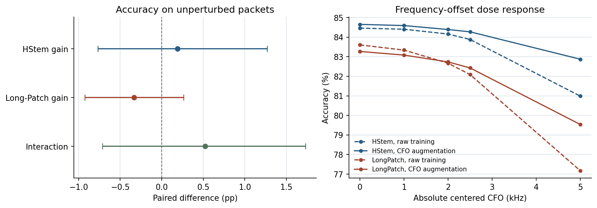

# S31 ManyRx 单因素 CFO 增强

本轮直接复用 S29 的 8 个未增强模型及 S30 的剂量预测，在相同源域两视图、两个种子和两个结构下新增 8 次在线增强训练。两个留出视图包含 12 台历史源域 RX、22,968 个未均衡包。新增训练设置为逐次读取以 0.5 概率在原始 IQ 注入均匀 −2.5 至 +2.5 kHz 的中心参考频偏，未注入时沿用原频谱字节。保持 CE、40 轮和 batch128。未扰动的训练侧验证按 RX 等权 CE 选模。

条件 95% 区间先在每台 RX 内平均两种子，再按视图分层重抽 RX，10,000 次。主端点使用同一批未扰动包。剂量面积是 0/1/2/2.5/5 kHz 下，以各组自己的干净准确率为基线的平均损失，正负频偏等权。视图和 RX 曾用于 S29/S30，实验结论属于历史源域开发。

## 四格结果

| 结构 | 训练处理 | 原始准确率 | 原始 Macro-F1 | 最差 RX 准确率 | 0–5 kHz 平均损失 | ±5 kHz 准确率 |
|---|---|---:|---:|---:|---:|---:|
| HStem | 原训练 | 84.46% | 80.61% | 69.23% | 1.10 pp | 80.99% |
| HStem | CFO 增强 | 84.66% | 80.95% | 68.35% | 0.61 pp | 82.87% |
| Long-Patch | 原训练 | 83.60% | 80.09% | 67.25% | 2.26 pp | 77.17% |
| Long-Patch | CFO 增强 | 83.27% | 79.51% | 65.10% | 1.31 pp | 79.54% |

| 原始输入比较 | 平均差 | 95% 条件区间 | V0 / V1 |
|---|---:|---:|---:|
| HStem 增强增益 | +0.19 pp | [−0.77, +1.27] | −0.71 / +1.09 pp |
| Long-Patch 增强增益 | −0.33 pp | [−0.93, +0.26] | +0.08 / −0.74 pp |
| 结构 × 增强交互 | +0.52 pp | [−0.71, +1.73] | −0.79 / +1.84 pp |
| 增强下 HStem−Long-Patch | +1.38 pp | [+0.71, +2.04] | +0.04 / +2.73 pp |

增强后 HStem 和 Long-Patch 的横向差异为 +1.38 pp，包含原结构差异及 Long-Patch 的平均下降。每个结构相对自身基线的增益及其差中差用于判断增强收益和协同。



## 鲁棒性与接收机风险

HStem 的 0–5 kHz 掉分面积减少 0.49 pp，区间 [+0.29, +0.69]。Long-Patch 减少 0.95 pp，区间 [+0.69, +1.20]。±5 kHz 的绝对准确率分别提升 1.89、2.37 pp，说明低幅训练增强的收益可传递到更强的人工频偏测试点。±2.5 kHz 的绝对准确率仅分别提升 0.39、0.34 pp。天然未扰动输入的主结果和剂量结果应各自解释。

HStem 有 3/4 个训练配对天然增益为正。最差配对 RX 是 24-16，先平均两种子后下降 2.63 pp。单种子最差为 V0 seed0 的 7-7，下降 9.40 pp。绝对准确率最低的 8-14 从 69.23% 降至 68.35%。在每个种子的支持量至少 50 包的 TX×RX 单元中，HStem 最大错误率增加 64.0 pp（V0 seed0、RX 24-16、TX 编码 5，200 包），Long-Patch 最大增加 59.5 pp（V0 seed1、RX 7-7、TX 编码 4，200 包）。这些单条轨迹风险作为描述性结果完整保存。

## 决策与执行核验

**STOP_SOURCE_GATE。** HStem 通过了 3/4 正向、Macro-F1、剂量面积和部署路径门。原始平均增益不足 1 pp、区间跨零、两视图方向相反，最差配对与最低绝对准确率也未达门。S31 结果支持两种结构可以学到更强的注入 CFO 鲁棒性，当前增强配方在天然跨 RX 的性能收益仍缺少证据。交互区间跨零。依冻结方案停止在源域开发，未进入独立确认或正式 CRD。

8 次拟合合计 320 轮、40,640 次优化更新，训练循环耗时约 291 秒。S29 配对基线的训练循环约 214 秒，新增在线旋转和频谱计算增加了训练时间。配对初态和逐轮样本顺序哈希与 S29 一致。两种结构共享每个视图和种子的频偏抽样，四条序列的非零注入率为 49.99%–50.06%。所有选模均在训练 RX 的未扰动验证包进行，选中轮次为 3–7。复算确认 8 对权重张量模式、8 对逐包预测、3 项配对差及 4 组剂量面积。部署使用原前向路径，HStem 为 82,426 参数，Long-Patch 为 82,364 参数。

## 复算

- [冻结方案](PROTOCOL.zh-CN.md)、[训练和推理入口](run.py)、[统计](analyze.py)、[逐包复算程序](verify.py)。
- [汇总与晋级决策](evidence/SUMMARY.json)、[训练封存](evidence/FIT_SEAL.json)、[预测封存](evidence/PREDICTION_SEAL.json)、[逐 RX 指标](evidence/RX_METRICS.csv)、[逐 TX×RX 原始输入风险](evidence/NATIVE_TX_RX.csv)、[复算记录](evidence/QA.json)。
- 本地 `D:/crossatten/.execution-s31` 保留 8 份所选权重、逐包 logits、4 份有效频偏序列及每个模型的训练记录。复算过程读取这些文件和 S29/S30 已封存的预测。

```powershell
$python = 'D:/crossatten/.venv/Scripts/python.exe'
$s29 = 'D:/crossatten/.execution-s29'
$s30 = 'D:/crossatten/.execution-s30'
$s31 = 'D:/crossatten/.execution-s31'
& $python research/s31_wisig/analyze.py $s29 $s30 $s31
& $python research/s31_wisig/verify.py $s29 $s30 $s31
```
