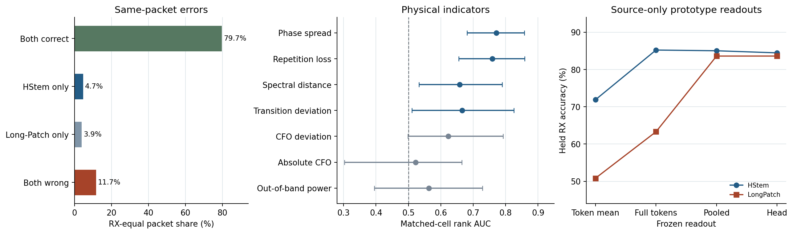

# S33 ManyRx 天然错误机制审计

S33 完成 S29 无增强 HStem/Long-Patch 的同包审计，并加入同协议 W4/W5 A1 强参照。使用 V0/V1 两套历史源域留出视图的 12 台 RX、22,968 个未扰动包及两个配对种子。8 份 S29 权重只做冻结前向。A1 复用 4 份源域留出预测，逐包核对索引、标签、接收机、日期与原文件哈希。A1 含辅助监督预训练和 EMA 配方差异。历史 ASKNet 的分割为 S20/W4-E 另一协议，因此只保留其历史结果。本轮新增模型训练及优化步骤均为 0。

## A 同包重合与互补

| 主对照四类 | RX 等权比例 | 95% 条件区间 |
|---|---:|---:|
| 两者都对 | 79.73% | [75.76, 83.85] |
| 仅 HStem 正确 | 4.73% | [3.65, 5.83] |
| 仅 Long-Patch 正确 | 3.87% | [2.98, 4.85] |
| 两者都错 | 11.66% | [8.28, 15.18] |

同 TX×RX×Day 内按两模型独立犯错计算的预期共错率为 7.26%。观察超额为 **4.40 pp**，条件区间 [2.70, 6.09]。V0/V1 的共错率分别为 7.91% 和 15.41%。两套种子均共错的唯一缓存包为 1,994 个。最难的 RX 8-14 在 D1/D2 的共错率分别为 30.40%/22.55%。冻结模型平均出现额外共错，组级难度已解释一部分重合。

| 模型或标签 oracle | RX 等权准确率 |
|---|---:|
| HStem | 84.46% |
| Long-Patch | 83.60% |
| W4/W5 A1 | 88.21% |
| HStem 或 Long-Patch 正确 | 88.34% |
| 三者至少一个正确 | 91.67% |

A1 救回 3.33% 的全体包，约占 HStem/Long-Patch 共错的 28.5%。三者仍在 8.33% 的包上共同出错，两套种子均三者共同出错的唯一缓存包为 1,330 个。Oracle 使用真实标签决定样本是否被救回，因此仅作为现有预测的诊断上限。其余结果无需拟合融合或路由器。

两主模型共同错成相同类别的全包比例为 5.25%。按两个种子的预测累计，最常见方向为 TX 编码 8→0（212 条，7 RX）、2→1（162 条，7 RX）和 1→0（154 条，9 RX），均出现在两日、两种子。逐 RX、逐日与逐 TX 混淆表保留所有方向。对共错包，HStem/Long-Patch 的 RX 等权标准化 margin 约为 −1.19/−1.28；两者都对时分别为 +1.68/+1.53。Margin 对应各模型相对得分，不能直接作物理距离解释。

## B 稳定关联集中在前导重复一致性

每个比较在 TX×RX×Day 内用共错包和全对包计算秩 AUC。AUC 大于 0.5 表示共错包通常有更大的指标值。只纳入两组各至少有 8 个有效包的单元。区间按视图分层重抽 RX，做 7 项家族校正，条件于两固定种子和历史源域 RX。

| 预定指标 | 共错 AUC | 家族校正条件区间 | 支持 RX / seed×单元 | 双模型门 |
|---|---:|---:|---:|---|
| 重复相干性损失 | 0.759 | [0.656, 0.859] | 12 / 148 | 通过 |
| 块间 CFO 相位估计离散度 | 0.771 | [0.681, 0.858] | 12 / 148 | 通过 |
| 与源 TX×Day 参考的谱形距离 | 0.658 | [0.532, 0.789] | 12 / 148 | 通过 |
| 周期转折偏离 | 0.665 | [0.511, 0.825] | 10 / 48 | 通过 |
| 绝对自然 CFO | 0.523 | [0.303, 0.665] | 6 / 13 | 未通过 |
| 相对源 TX×Day 的 CFO 偏离 | 0.623 | [0.499, 0.793] | 6 / 13 | 未通过 |
| 带外能量占比 | 0.564 | [0.395, 0.728] | 12 / 148 | 未通过 |

加入 A1 后，重复相干性、块间相位和谱形仍通过同样的诊断条件，AUC 分别为 **0.807、0.837、0.687**。周期转折在三模型对照只得到 5 台 RX 的支持，V0 为 0.500。这里的两个相干性主读数来自相同的前导重复结构，不提供独立的物理证据。可靠 CFO 覆盖率从两者都对的 60.25% 降至两者都错的 22.93%；周期转折覆盖率从 98.07% 降至 42.71%（按包×种子计）。因此 CFO 偏离的关联仍受覆盖不足约束，质量最差的样本尤其缺少可靠频偏值。

稳定线索是前导局部一致性下降与谱形偏离。它们可能共同受信道、裁窗、干扰或其他接收条件影响。相干性残差只作噪声相关代理，256 点窗口缺少独立噪声基准；周期转折为窗口内的边界代理，绝对时移尚未识别。当前证据不足以从这些关联中挑出单一接收机失真。

## C 冻结表示与后端读出

两模型仅用各自 fit_train 计算归一化的 TX 原型。位置均值、保留位置的全 Token 展开和池化表示均使用固定余弦最近原型。训练侧验证和源域留出都用同一套原型。没有优化新分类器，也没有从留出 RX 估计原型。原分类头仅用于参照。

| 冻结读出 | HStem 训练侧验证 | HStem 留出 RX | Long-Patch 训练侧验证 | Long-Patch 留出 RX |
|---|---:|---:|---:|---:|
| Token 位置均值 | 79.83% | 71.88% | 59.00% | 50.82% |
| 展开全部 Token | 90.18% | 85.22% | 75.29% | 63.29% |
| 最终池化 | 92.20% | 85.02% | 90.76% | 83.60% |
| 原分类头 | 92.21% | 84.46% | 91.35% | 83.60% |

在两主模型原头均错的包上，HStem 位置保留的 Token 原型可判对 21.26%，同模型的池化原型为 8.30%；Long-Patch 的相应值为 16.70% 和 8.35%。这表明一部分真实错误包在位置保留 Token 里仍可读出 TX 信息。全体留出包中，HStem 两个原型读出接近，Long-Patch 依赖后端聚合才能达到 83.60%。TX×RX×Day 中心偏移相对源异类最近距离的中位数，从 HStem 的 1.18 降到 0.23，Long-Patch 从 1.90 降到 0.25。层间度量与归一化随表示改变，现有读出支持有损子集的进一步审计，无法把损失唯一归因给池化或注意力。

## 研究出口

S29–S31 的 CFO 增强路线以 S31 停止判定结题，S32 未启动。S33 提供两条更直接的天然错误线索。第一条是前导重复一致性与谱形偏离的共错风险，第二条是部分共错包的判别信息仍在位置保留 Token 上。若有独立条件，优先验证这些关联是否跨新 RX 和采集条件复现，再用同包受控观测辨别窗截取与重复结构破坏。当前结果属于源域开发，LoRa 主模型和原正式配置均未修改。

## 核验与复算

- [冻结方案](PROTOCOL.zh-CN.md)、[错误与物理读数](evidence/SUMMARY.json)、[同包与权重核验](evidence/RECEIPT.json)、[独立复算](evidence/QA.json)。
- [逐 RX 错误](evidence/RX_ERRORS.csv)、[逐 RX×Day 错误](evidence/RX_DAY_ERRORS.csv)、[逐单元 AUC](evidence/PHYSICAL_CELL_AUC.csv)、[固定读出](evidence/CENTROID_PROBE.csv)、[共同错标签](evidence/WRONG_LABELS.csv)、[全模型混淆](evidence/CONFUSION.csv)。
- 独立复算通过 24 个 RX×种子读数、8 项重合指标、6,440 项单元支持与其中 1,198 项有支持的 AUC。原 HStem/Long-Patch 的 8 组留出预测全部逐包重放一致。完整派生数据保存在本地 `D:/crossatten/.execution-s33`，含原型预测、质量代理、逐包 logits、全模型混淆和中心偏移。
