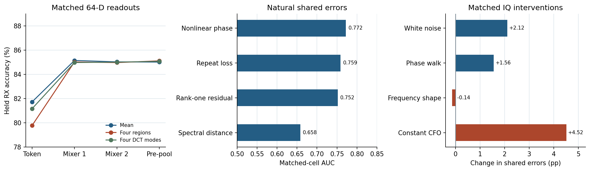

# S34 WiSig 位置读出与前导重复结构

**S34-A 两个候选均未过门。S34-B 拆开了共错增加与重复结构破坏。** 复用 S29 的 8 份权重、S33 同包标签和 A1 预测，对 12 台历史源域留出 RX、22,968 个包作冻结诊断。主干训练与优化器步均为 0。A 部分新增 298 个源域类原型读出和对应的 298 个正则化线性读出，后者各求解三档正则。B 部分追加三组同宽波形原型。外层目标 RX、新日期、ManySig 和 Shen 未进入本轮。

## A 位置与读出容量

下表固定使用 HStem，所有新读出统一到 64 维、同一个线性分类器形式。选择只使用训练 RX 的未扰动验证。本表共错子集沿用 S33 两个原模型同时出错的固定定义。

| 位置和读出 | 全体 | 双共错 | 三共错 |
|---|---:|---:|---:|
| 原五通道频谱，固定投影 | 47.84% | 11.80% | 10.10% |
| HStem Token，均值 | 81.73% | 16.19% | 12.25% |
| 第一层 Mixer，均值 | 85.15% | 11.84% | 5.74% |
| 最后一层 Mixer，均值 | 85.03% | 10.70% | 5.84% |
| 最终 LayerNorm 后，均值 | 85.01% | 10.86% | 6.37% |
| 最终 LayerNorm 后，四连续区域 | 85.12% | 10.75% | 6.39% |
| 最终 LayerNorm 后，四项 DCT | 85.08% | 10.14% | 5.97% |
| 原分类头 | 84.46% | 0%（按定义） | 0%（按定义） |

区域读出按连续频率位置分组，宽读出使用固定正交矩阵压到 64 维。两区域、均值加标准差、展开压缩、逐包乱序、随机正交位置基和原型的全结果在 A 的表中。均值读出与现有池化向量的新线性读出逐包等价，并经独立复算。

| 池化前候选 | 相对同维均值，全体 | V0 / V1 | 相对同维均值，双共错 | 相对逐包乱序 | 相对随机位置基 |
|---|---:|---:|---:|---:|---:|
| DCT4 | +0.06 pp [−0.14, +0.28] | +0.13 / −0.01 pp | −0.72 pp | +0.22 pp | +0.13 pp |
| 四区域 | +0.10 pp [−0.11, +0.35] | +0.27 / −0.07 pp | −0.11 pp | +0.17 pp | +0.17 pp |

区间仅对历史 RX 和固定种子有条件。两个位置候选都优于自身的乱序负对照，均值增益不足 0.5 pp、双共错增益不足 5 pp，且 V1 方向为负。它们分别落后同包 A1 **3.14 / 3.10 pp**。固定投影未增加可学习分类器参数，稠密基和投影仍带来存储与运算成本。

**混合后的表征有整体收益，局部困难样本呈相反变化。** HStem 同维均值线性读出经过第一层 Mixer 后，全体提高 3.42 pp，双共错下降 4.35 pp。S33 曾将原 Token 的 2048 维原型和后端 64 维原型比较。S34 中，把原 Token 展开压到 64 维后仍能判对 19.12% 的共错包，原 Token 的同维均值原型也达到 20.42%，高于后端池化的 8.30%。同一早期层内，显式位置在这组匹配原型上没有额外恢复。这使「早期特征仍可读」与「必须改最终位置池化」成为两个独立判断。不同层在两种固定读出下的可读性变化无法唯一定位到某个 Mixer 算子，也无法保证双路读出可安全恢复这些包。

HStem Token 层的各位置 TX 分离/跨 RX 中心偏移比，在两视图 fit 中秩相关为 0.944，在两视图留出中为 0.285。池化前两视图留出秩相关为 −0.032。这个结果与固定最佳频带的设想缺少一致性，受不同视图及权重变化共同影响。质量四分位只用 fit_train 冻结分割。HStem 原头最稳定一档为 91.35%，最不稳定一档为 66.58%，完整四档结果保留在 A 的表中。

## B 固定六块的共享波形、残差和受控干预

原包共错组与全对组的比较仍在同 TX×RX×Day 单元内。六块前导秩一残差能量、累计相位去线性趋势后的 RMS 的 AUC 分别为 **0.752 和 0.772**，各覆盖 12 台 RX 和 148 个支持的 seed×单元。前、中、后三个重叠段的重复相干性损失 AUC 分别为 **0.725、0.727、0.728**，尾参照为 0.593。证据覆盖相邻的多个前段窗口，本实验的窗长和步长无法定位 AGC 瞬态或天然绝对时移。

同为 120 维谱幅特征、同一训练 RX 原型算法，原六块、秩一共享分量、残差分量的留出准确率分别为 **26.22%、25.98%、30.35%**。这个对照显示两部分均保留了可读出的 TX 相关信息。不同分量都可能混合信道、设备和窗口效应。

四种干预逐包匹配原 IQ 相对 L2 偏移 0.12，最大剂量误差低于 1.84e−6。下表共错变化按整个原包队列的同包配对计算，物理指标变化按原两模型都对的子集计算，再对 RX 等权。

| 固定干预 | 共错变化 | 秩一残差能量比例变化 | 非线性相位 RMS 变化 | 谱形距离变化 |
|---|---:|---:|---:|---:|
| 复白噪声 | +2.12 pp | +0.01086 | +0.00772 rad | −0.00878 |
| 去线性随机游走相位 | +1.56 pp | +0.00276 | +0.05169 rad | −0.00068 |
| 固定三抽头频响变化 | −0.14 pp | −0.00080 | +0.00013 rad | +0.00318 |
| 包中心锚定恒定 CFO | +4.52 pp | 约 0 | 约 0 | +0.00012 |

白噪声与非线性相位分别复现了天然共错签名的一部分。恒定频偏在这次剂量下造成更大共错增加，重复结构本身基本保持，说明共错率上升与前导重复破坏可由不同干预引起。所测三抽头频响只轻度移动谱形，结果限定于这一响应、剂量和窗内分析。四种固定干预没有同时重现观察到的天然共错特征。P6 沿用 M0 本地身份门，官方有等长的未均衡和均衡版本，当前文件缺少可核对的逐包映射，所以没有执行同包 Raw/EQ。 [WiSig 官方概述](https://cores.ee.ucla.edu/wisig/overview/) · [M0 配对核验](../wisig_raw_eq_m0/README.zh-CN.md)

## 研究出口与复算

**S35 和 S36 未启动。** 最终池化的位置候选未过冻结门槛。S34 保留了早期 TX 特征可读、后端整体有益但困难子集读出下降这一线索，以及区分重复损伤和恒定 CFO 的干预证据。S29–S31 保持结题判定。

- [冻结方案](PROTOCOL.zh-CN.md) · [A 汇总与晋级门](evidence/A/SUMMARY.json) · [A 各 RX 队列](evidence/A/METRICS.csv) · [B 干预分解](evidence/B/INTERVENTIONS.csv) · [B 天然单元](evidence/B/NATURAL_CELLS.csv) · [独立复算](evidence/QA.json)
- 独立复算通过 298 组源验证选择、96 项候选 RX×seed×子集读数、16 组池化/均值逐包等价、1,184 个有支持的物理单元和 91,872 个剂量读数。逐包预测及物理数组位于本地 `D:/crossatten/.execution-s34`。
