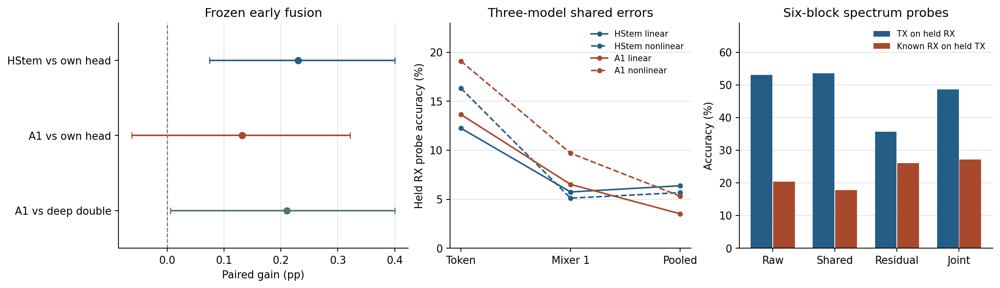

# S36 A1 早期判别信息与冻结融合

**判定为 STOP_SOURCE_GATE。** 浅层信息存在可恢复空间，当前冻结融合对 A1 的天然源留出增益只有 +0.13 pp，未过晋级门。复用 S29 HStem 和 W4/W5 A1 各 4 份匹配权重，覆盖 12 台历史源域留出 RX、22,968 个未扰动包。A–D 新增 88 个线性读出和 80 个 610 参数非线性探针。后者的 10,240 次优化步骤全部更新探针。主干、原头和 BN 冻结，主干训练及更新均为零。E 部分拟合源域线性与原型读出，无优化器更新。

## A/B 同包转移、真实上限与复现性

以下四类按 RX 和两个种子等权。浅层为原 Token 均值的同维 ridge，随后为第一层后的同维 ridge 或冻结原分类头。

| 模型和后续读出 | 两者都对 | 仅浅层对 | 仅后续对 | 两者都错 | 标签 Oracle |
|---|---:|---:|---:|---:|---:|
| HStem 第一层后 | 78.67% | 3.06% | 6.48% | 11.79% | 88.21% |
| HStem 冻结原头 | 78.34% | 3.39% | 6.12% | 12.15% | 87.85% |
| A1 第一层后 | 79.72% | 2.42% | 7.67% | 10.18% | 89.82% |
| A1 冻结原头 | 80.07% | 2.07% | 8.14% | 9.71% | 90.29% |

HStem 浅对原头错的样本中，同 seed A1 已判对约 **61.7%**。即使逐包用真标签选 HStem 的浅层或原头，Oracle 87.85% 仍低于同包 A1 原头的 88.21%。A1 自己的浅层相对原头有 2.07 pp 理想救回空间，Oracle 90.29%，需要预知每个包哪个头正确。

两方的浅对原头错集合跨种子的 Jaccard 仅 **7.15% / 8.29%**。HStem 的这些包在最差重复相干四分位占 4.40%，最好四分位占 3.14%；A1 对应 **3.64% / 0.75%**。A1 的主要 RX 聚集在 7-14，先平均两种子后，该 RX 有 8.28% 的包仅浅层正确；按包×种子累计，TX 编码 4 的浅对原头错比例最高（4.25%）。对应的标准化得分间隔，HStem 为 0.69、A1 为 0.71；各自所有浅层正确包的平均为 1.67、1.57。存在低间隔和训练实例敏感性。四分位和 TX/RX 分布用于定位，不用于样本选择或融合校准。

## C 冻结主干的融合效果

温度和 α 全由训练 RX 的未扰动验证包选出。三种融合均新增一个 650 参数线性头。容量对照从深层池化重拟合同规格头，乱序对照在角色内同 RX×Day 重配浅向量。

| 同包比较 | 配对差 | 95% 条件 RX 区间 | V0 / V1 |
|---|---:|---:|---:|
| HStem 浅融相对原头 | +0.23 pp | [+0.07, +0.40] | +0.46 / 0.00 pp |
| HStem 浅融相对 A1 原头 | −3.52 pp | [−4.58, −2.62] | −3.53 / −3.51 pp |
| A1 浅融相对原头 | +0.13 pp | [−0.06, +0.32] | +0.32 / −0.05 pp |
| A1 浅融相对深层双头 | +0.21 pp | [+0.01, +0.40] | +0.47 / −0.05 pp |
| A1 浅融相对浅层乱序 | +0.19 pp | [−0.03, +0.41] | +0.43 / −0.05 pp |

A1 原头、浅融、深层双头及乱序融合准确率分别为 **88.21%、88.35%、88.14%、88.16%**。A1 的最差配对 RX 为 −0.64 pp，Macro-F1 平均变化 +0.14 pp。学习参数增加 0.79%，另有固定校准标量及取浅层均值的计算。相对原头的平均增益、两视图方向和区间三项未通过；A1 点估计也低于额定 0.5 pp 的探索尺度。结果支持停止当前固定融合配方。这批 A1 浅层预测的 Oracle 余量仍存在，未能在本配方中转化为稳定投入理由。共错标签未参与训练或验证。

## D 第一层实际算子

S29 HStem 和 A1 都是两层 PlainMHA，第一层顺序是位置/输入映射与独立 pre-LN，接着 QKV、多头注意力加权与输出投影，再做残差加和及块后 LayerNorm。实际实现没有 FFN。全部 tap 的均值或向量同为 64 维。

| 历史三模型共错上的读出 | HStem 线性 | HStem 窄 MLP | A1 线性 | A1 窄 MLP |
|---|---:|---:|---:|---:|
| 原 Token | 12.25% | 16.33% | 13.65% | 19.10% |
| 输入 LayerNorm 后 | 13.01% | 14.76% | 14.78% | 16.46% |
| 注意力输出投影 | 5.33% | 7.17% | 7.70% | 10.26% |
| 残差加和 | 6.54% | 5.25% | 7.15% | 10.32% |
| 第一层完整输出 | 5.74% | 5.11% | 6.51% | 9.70% |
| 最终池化 | 6.37% | 5.67% | 3.51% | 5.31% |

同一 A1 在全体包上的线性读出从原 Token 的 82.14% 升到第一层后的 87.40%。在两主模型共错子集，A1 的线性读出也从 23.76% 升到 32.80%；加入 A1 原头错误约束形成三共错子集后，方向转为下降。窄 MLP 的结果在三共错子集维持这个下降，能力有限的两类探针都看到了后端可读性的改变。困难子集定义包含原头错误，比较受选择效应影响。此处未识别信息论损失或模块训练的因果贡献。

直接把第一层替换为仅自位置的注意力或去掉注意力分支，A1 原头准确率分别降到 **39.32% / 45.79%**；跳过第一层块后归一为 **88.25%**，原头为 **88.21%**。这些干预让原训练权重接收分布外输入。它们说明当前分类依赖学到的跨位置混合，无法把正常模型中的局部失误单独归因给注意力传播或归一化。

## E 重复前导共享与残差

沿用 S34 六块固定窗口的秩一分解及相同的 120 维谱幅特征。共同 TX 指标为留出 RX 上 RX 等权准确率。RX 读出只在已知训练 RX 类别内评估，用 TX 奇偶两组互换训练和验证，分数为平衡准确率，随机参照约 8.33%。Day 是留出 RX 上逐 RX 的两日平衡准确率。

| 表示 | TX 线性 | TX 原型 | 已知 RX 跨 TX | Day 跨 RX |
|---|---:|---:|---:|---:|
| 原六块 | 53.04% | 26.22% | 20.41% | 50.79% |
| 秩一共享 | 53.48% | 25.98% | 17.75% | 49.73% |
| 残差 | 35.68% | 30.35% | 26.05% | 50.32% |
| 两分量拼接后固定压到 120 维 | 48.55% | 32.86% | 27.10% | 50.31% |

残差在两视图上的 TX 线性读出分别为 35.63% 和 35.73%，同时携带更多可读出的已知 RX 信息。共享与残差线性预测的标签 Oracle 为 64.60%；同维联合线性读出低于单独共享，联合原型仍比共享原型高。结论受读出形式及固定投影约束。Raw/EQ 的官方双版本仍保留为外部依据，本地逐包配对资格未改变。 [WiSig 官方概述](https://cores.ee.ucla.edu/wisig/overview/) · [M0 核验](../wisig_raw_eq_m0/README.zh-CN.md)

## 研究出口

S36 完成了对 A1 的优先复验、固定融合公平控制、实际算子诊断和前导成分可迁移性读数。**S37/S38 未启动。** 现有结果足以解释为什么浅层 Oracle 不能直接折算成天然跨接收机增益。个别 TX×RX×Day 的早期信号可读性和独立采集上的复现仍是未回答的两个问题。LoRa 主模型、CFO 和位置读出的历史停止判定均保持。

- [事前方案](PROTOCOL.zh-CN.md) · [A–D 数据及决策](evidence/AD/SUMMARY.json) · [RX×TX×Day 转移](evidence/AD/TX_RX_DAY_TRANSITIONS.csv) · [E 成分诊断](evidence/E/SUMMARY.json) · [独立核验](evidence/QA.json)
- 本地 `D:/crossatten/.execution-s36` 保留逐包 logits、预测、所有固定校准和选择轨迹。复算通过 8 组历史浅/第一层读出逐包重放、8 份原头、24 组校准、80 个非线性选定轮次以及四组前导 TX 端点。
