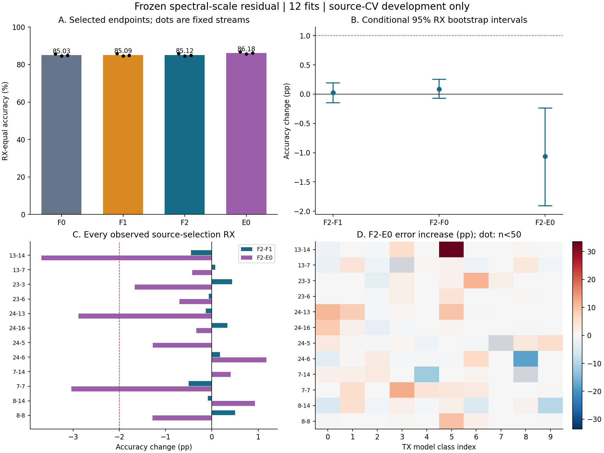
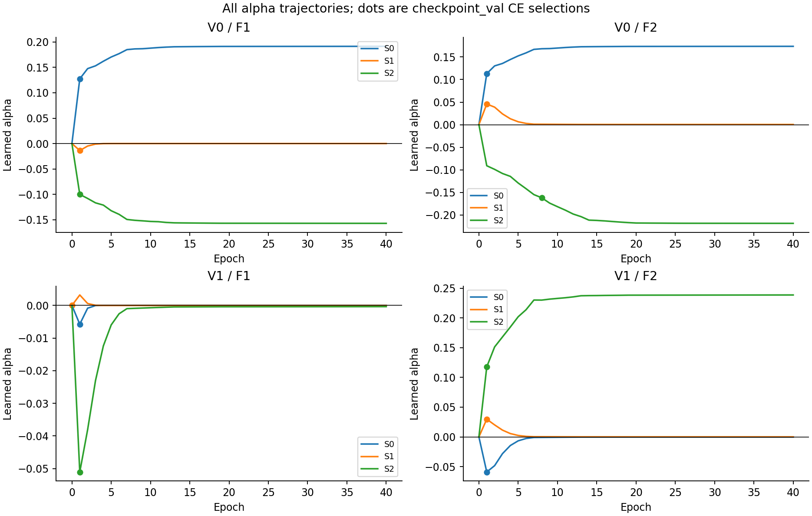

# F2 冻结频域尺度残差：完整源域结果

**12/12 次科学拟合完成；判定：`STOP_F2_FROZEN_BACKBONE_RESIDUAL`。** 原设计 `2121255`、工程 `9fccd65` 的结构、训练配方和门槛未改。全部结果属于重复使用合法源角色的 source-CV 开发研究，不是独立确认或正式 CRD。

## selected 主端点

| 结构 | RX 等权 Accuracy | Macro-F1 | CE | 最差 RX Accuracy | 总参数 / 本轮训练参数 |
|---|---:|---:|---:|---|---:|
| F0 | 85.0332% | 81.3311% | 0.516880 | 8-14: 71.0833% | 82,426 / 0 |
| F1 | 85.0929% | 81.4175% | 0.512757 | 8-14: 71.0833% | 85,627 / 3,201 |
| F2 | 85.1169% | 81.4566% | 0.511367 | 8-14: 71.0000% | 85,627 / 3,201 |
| E0 | 86.1811% | 82.6064% | 0.486013 | 8-14: 70.0667% | 82,426 / 0 |

F0 为原六个 P0 的冻结回放，E0 为原六个 EMA 完整配方的冻结回放；两者不做本轮拟合。F1 是普通宽频域卷积控制，F2 是唯一细/宽并行候选。两者各新增 3,201 参数、最大名义频率跨度相同，拓扑、非线性和计算量不完全相同。

| 比较 | Accuracy 差 / pp | RX 条件 95% 区间 / pp | 最差配对 RX 差 / pp | 最大受支持 TX×RX 风险增加 / pp |
|---|---:|---|---:|---:|
| F2-F1 | +0.0240 | [-0.1459, +0.1935] | -0.5000 | +4.5000 |
| F2-F0 | +0.0837 | [-0.0732, +0.2503] | -0.4500 | +4.5000 |
| F2-E0 | -1.0642 | [-1.9099, -0.2359] | -3.6833 | +33.5000 |

## 原联合门与实际纠错

- F2-F1：未通过；未过项：mean_accuracy_at_least_1pp, paired_rx_interval_lower_above_zero, both_views_positive。
- F2-F0：未通过；未过项：mean_accuracy_at_least_1pp, paired_rx_interval_lower_above_zero, both_views_positive。
- F2-E0：未通过；未过项：mean_accuracy_at_least_1pp, paired_rx_interval_lower_above_zero, both_views_positive, at_least_two_streams_positive, worst_paired_rx_at_least_minus_2pp, supported_tx_rx_risk_increase_at_most_5pp。

三个比较均需同时满足：平均至少 +1 pp、条件区间下界 >0、两视图均正、至少 2/3 流正、最差配对 RX ≥−2 pp、每流支持≥50的全部 TX×RX 流均值风险增加≤5 pp。支持不乘以三个种子；未观察组不伪造为零风险。

| 相对参照 | 纠正错误 / 全部输入 | 新增错误 / 全部输入 | 预测不一致 |
|---|---:|---:|---:|
| F2-F1 | 0.2387% | 0.2147% | 0.8138% |
| F2-F0 | 0.4099% | 0.3262% | 1.3447% |
| F2-E0 | 1.7642% | 2.8284% | 8.1946% |

以上为 RX 等权并先平均固定三流的比例；纠错数量不能单独替代净准确率与风险门。12 个已观察 RX 为 bootstrap cluster，10,000 次、seed24501。区间未覆盖新 RX 总体、seed 总体或历史开发选择偏差，多比较未校正。

## 所有辅助端点与固定流

| 端点 | F0 Accuracy | F1 Accuracy | F2 Accuracy | E0 Accuracy |
|---|---:|---:|---:|---:|
| selected | 85.0332% | 85.0929% | 85.1169% | 86.1811% |
| epoch10 | 85.0332% | 85.0187% | 85.0939% | 86.1811% |
| final40 | 85.0332% | 85.0245% | 85.1335% | 86.1811% |

只有 selected 决定晋级；epoch10/final40 不得取代主端点，不扫描 alpha 或选择局部有效分支。

| 结构 | V0 | V1 | S0 | S1 | S2 |
|---|---:|---:|---:|---:|---:|
| F0 | 88.4209% | 81.6455% | 85.6581% | 84.5349% | 84.9064% |
| F1 | 88.5403% | 81.6455% | 85.8297% | 84.5349% | 84.9141% |
| F2 | 88.6987% | 81.5350% | 85.8811% | 84.5349% | 84.9346% |
| E0 | 89.4873% | 82.8748% | 86.7288% | 85.7278% | 86.0866% |

完整每 RX、TX×RX、日期、混淆计数、缺失组及三端点记录见 [ANALYSIS.json.gz](ANALYSIS.json.gz) 和 [SUMMARY.json](SUMMARY.json)。

## 预检、冻结与执行证据

六个 P0、六个 EMA 的真实 checkpoint_val 预检最大 logit 差全部为 0，argmax 一致；六组 F1/F2 在 alpha=0 时与 F0 位级一致。预检提交后自动进入十二次拟合；全部训练封存提交后，才读取两份合法 source_selection。评价时 F0/E0 再与历史封存预测核对，误差及身份见 [EVALUATION_MANIFEST.json](EVALUATION_MANIFEST.json)。

本轮 480 epoch、60,960 次更新，无科学失败重试。独立复算通过 8,350 项：逐份核验原设计/工程 SHA、492 份初始及 epoch 全状态、480 个 epoch 的冻结参数与 BN、实际配对包序、全部梯度与 alpha、epoch0–40 的 CE 最早最小选择，以及第二份 NumPy 实现的全部主统计和联合门。见 [INDEPENDENT_QA.json](INDEPENDENT_QA.json)。

alpha 轨迹完整保留。首步侧路任务梯度为零与 coupled Adam weight decay 导致参数移动分开记录；不因 alpha 小而改初值或 LR。

| 拟合 | selected epoch | selected alpha | final alpha |
|---|---:|---:|---:|
| V0_S0_F1 | 1 | +0.12749726 | +0.19151779 |
| V0_S0_F2 | 1 | +0.11319311 | +0.17366198 |
| V0_S1_F1 | 1 | -0.01384051 | -0.00000000 |
| V0_S1_F2 | 1 | +0.04583983 | +0.00042206 |
| V0_S2_F1 | 1 | -0.10015258 | -0.15723063 |
| V0_S2_F2 | 8 | -0.16205449 | -0.21867563 |
| V1_S0_F1 | 1 | -0.00574323 | -0.00000000 |
| V1_S0_F2 | 1 | -0.05896055 | -0.00031905 |
| V1_S1_F1 | 0 | +0.00000000 | -0.00000000 |
| V1_S1_F2 | 1 | +0.02977533 | +0.00009846 |
| V1_S2_F1 | 1 | -0.05103854 | -0.00035662 |
| V1_S2_F2 | 1 | +0.11774138 | +0.23854783 |

## 训练与推断成本

| 侧路 | 新增拟合 / 更新 | 训练循环 / s | 验证 / s | 合成回退探针 / s | 各拟合 wall 总和 / s | 峰值已分配显存 / GiB |
|---|---:|---:|---:|---:|---:|---:|
| F1 | 6 / 30,480 | 217.29 | 32.17 | 1.64 | 509.46 | 0.142 |
| F2 | 6 / 30,480 | 220.80 | 32.73 | 1.66 | 513.70 | 0.140 |

整个 train-all 调用 wall 为 1379.28 s，包含逐阶段 SHA/提交验证与日志、封存开销；训练循环计时为 wall，不能称为纯 GPU kernel 时间。每次拟合开头的 setup() 重置显存峰值统计，表中取每臂六次运行的最大已分配显存；该值不是设备总显存占用。两臂复用同六个历史 P0，不把其预训练成本当零，也不在两臂间重复计作新增拟合。历史 P0 与 EMA/BN 完整配方的已用训练成本在 [COSTS.json](COSTS.json) 分列。

| 模型 | B=1 batch p50 / ms | B=128 batch p50 / ms | B=128 samples/s |
|---|---:|---:|---:|
| F0 | 2.2078 | 2.1673 | 57,719.4 |
| F1 | 2.4211 | 2.2710 | 54,444.0 |
| F2 | 2.4770 | 2.3580 | 52,383.2 |
| E0 | 2.2063 | 2.1123 | 58,307.0 |

延迟仅取事先固定的 V0/S0 selected 模型，完整前端到分类器、合成 CUDA 常驻输入，B=1/128；四轮平衡轮转，每轮 20 warmup +100 测量。表为各轮 p50 的中位数，完整测量与 p95 见 [LATENCY.json](LATENCY.json)。不含磁盘和主机传输，不选择最快 seed。

## 解释与封存

成功只支持固定频域判别器能利用当前附加信息，仍需另行确认；失败只否决冻结骨干、3,201 参数及登记训练配方下的这个候选，不扩大为所有多尺度方法无效。参数与最大跨度匹配不能唯一归因于多尺度物理机制，本轮不声称原创性。

F2 未通过全部登记门，按预注册 STOP。保留完整平均收益与局部变化，不微调 kernel、alpha、Loss 或解冻骨干重跑，不自动开展下一候选。

未读取 target8、历史 held6、Day3–4、Full WiSig 新 RX；此前固定窗口及 P2 的 STOP 证据均未改变。

公开 [48 份同输入预测](SOURCE_PREDICTIONS.zip)、[全部科学梯度/alpha/样本顺序轨迹](SCIENTIFIC_TRACES.zip)、[归档清单](ARTIFACT_ARCHIVE.json) 与 SHA。初始/逐 epoch 模型、optimizer/scheduler/RNG 和完整执行包留在本地忽略目录，不上传模型权重或原始 IQ。

授权原始 JSON 的中文转写曾受 PowerShell 管道编码影响；启动封装在调用科学训练器前拒绝了这一转写。已补存 [UTF-8 授权原文](USER_AUTHORIZATION.zh-CN.md) 与 [更正说明](AUTHORIZATION_TRANSCRIPTION_NOTE.json)，保留原授权及预检 SHA。该记录问题发生时科学尝试数为 0，未重试科学拟合。
