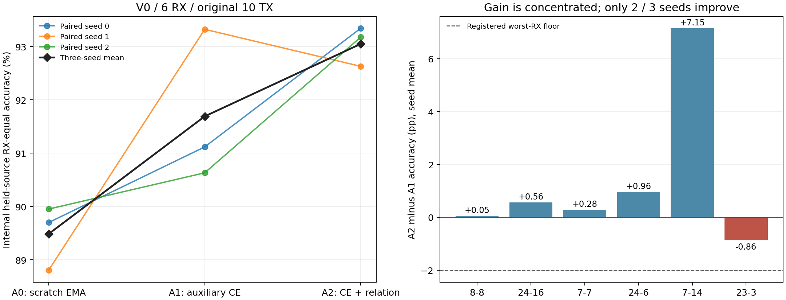
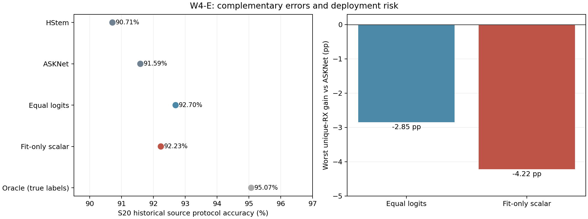

# W4 第一轮结题：性能已有正向信号，关系约束未通过稳定性门

**正式判断：`STOP_W4P_RELATIONAL_PRETRAINING_NOT_PROMOTED`。** A2达到平均+1pp及接收机均值风险门，但只有2/3种子超过A1，按预注册不晋级、不补seed、不改lambda、不启动第二视图。保留平均性能提升，不把一次稳定性失败扩大成“辅助TX或关系学习都无效”。

## 1. 先看最终10类分类结果

以下是**原C V0内部源域留RX**，三个配对seed、六个内部RX等权；不是实际目标CRD、D3/D4、外部新盲测，也不是公开排行榜成绩。

| 方法 | RX等权Accuracy | RX等权Macro-F1 | 最差RX（先平均seed） |
|---|---:|---:|---:|
| A0 | 89.4873% | 85.6783% | 78.3333% |
| A1 | 91.6902% | 88.5175% | 85.5000% |
| A2 | 93.0480% | 90.0636% | 88.7895% |

| seed | A0 | A1 | A2 | A2−A1 (pp) |
|---|---:|---:|---:|---:|
| 0 | 89.7006 | 91.1173 | 93.3414 | +2.2241 |
| 1 | 88.8085 | 93.3212 | 92.6275 | -0.6937 |
| 2 | 89.9528 | 90.6321 | 93.1751 | +2.5431 |

A1−A0平均 **+2.2029pp**、3/3正向；A2−A0平均 **+3.5607pp**、3/3正向。这已经是分类端的实际改善证据。

逐seed×RX仍有反例：A1−A0最坏为 **-4.9500pp**，A2−A0最坏为 **-4.6574pp**。先平均seed后的接收机均值风险，不能掩盖单条训练轨迹的局部退化。

核心机制比较A2−A1平均 **+1.3578pp**，95%条件RX区间 **[-0.1748, +3.7902]pp**，3/3同向门失败。六RX先平均seed后，最差配对差为 **-0.8596pp**；逐seed×RX最坏差仍达 **-3.6000pp**。二者不能混为同一种最差风险。

RX `7-14`的A2−A1为 **+7.1481pp**，占六RX净效应总和约 **87.7%**；其余五RX的平均增量只有 **+0.1997pp**。这是补充描述，不据此删除RX或重新定义主端点。它说明当前增益集中，不能只用93.05%的均值宣布稳定机制成立。

区间按同RX先平均三个seed，再对六RX聚类bootstrap10,000次（seed42101）。它条件于当前模型、seed和反复开发的六RX；不涵盖新设备、新采集或训练总体的不确定性。Macro-F1统一计入全部10类、零分母记0，所有缺失TX×RX支持单列；不与不同标签口径的旧表混用。

## 2. W4-E：存在可纠正错误，也有融合代价

S20四fold的每折最强单模型均为ASKNet。HStem、ASKNet、等权logit、fit-RX标量融合的RX等权均值分别为 **90.7118% / 91.5891% / 92.6975% / 92.2336%**。Oracle余量 **3.4840pp**，通过事前3pp预算门。

等权融合相对ASKNet平均 **+1.1083pp**；fit-RX CE标量融合平均 **+0.6444pp**。两者都在查看本轮预测前固定；没有看held标签调权重或温度。标量仅在各fold的fit18历史source-validation预测上拟合。

但等权融合最差唯一RX相对ASKNet **-2.8500pp**，最差单折RX **-5.0500pp**；标量融合对应 **-4.2167pp / -6.9000pp**。不能把平均改善解释成各RX均更安全，也不继续添加路由器搜索补救。部署仍需同时运行两个模型，融合本身不是免费推理或原创方法。

E只有12个唯一RX，fold×RX共24项含重复。历史NPZ没有显式独立packet-ID：配对依赖相同封存source-cell SHA、共同确定性加载顺序和逐行label/RX/day一致，重建的是缓存行身份，不是空口发射ID。只读保存预测及元数据，未访问这些历史held-source的原始IQ。E的S20协议与P的V0协议不同，92.70%与93.05%不能直接排名。

## 3. 数据、预算与控制

历史基线598ba17。96个辅助TX按SHA256('W4-TX-v1|TX')固定为72拟合/24诊断；目标ManyRx/ManySig并集11TX全部排除。辅助捕获RX仅 `13-7,14-7,18-19,18-2,8-14,8-7`，均属于V0 fit12；只用D1/D2、raw前32包。72TX每单元前24训练、后8验证，分别20,736/6,912包；24TX的9,216包在模型封存后才读。

原10TX下游仍为V0原来的16,246 train、6,954 checkpoint-val、11,468内部留出包。A0三份初始化、角色与验证logits逐比特重放一致，故严格复用。新增6次辅助预训练+6次下游微调=**12次科学拟合**，低于15次上限；正式梯度更新**56,400**，合成工程优化另24步，真实初始梯度探针无optimizer更新，没有科学拟合重试。

A1/A2每辅助batch为8TX×6RX×4包，40epoch×108步，样本顺序逐项一致；关系项比较规范化类间距离，不假设跨RX同次发射。三个lambda为0.02715589、0.03340068、0.02306884，仅按初始fit梯度比一次确定。下游完整复用原C循环：同40epoch、Adam/Plateau、EMA与RX等权CE选模，重置优化器；10类头与A0的随机头一致，骨干/BN来自所选辅助EMA。

全部12模型先封存，迁移/优化器/顺序核验通过后才评测；九组预测再次提交封存后才计算最终指标。关键提交：7df1e30（范围与角色）、d556e47（更新前执行注册）、677b828（模型封存）、ad57bda（首次新留出读取前评测注册）、b878bb2（最终指标前预测封存）。执行注册和模型封存均已先推送GitHub。

## 4. 24TX诊断与成本

未参与本次预训练的24TX上，有标签24类原型诊断A1/A2平均为 **43.1865% / 45.4955%**，差 **+2.3090pp**，3/3同向。每个RX/日期原型用32个有标签支持包，查询为另一日期的另一个源RX，共60条件。这支持表示有可迁移判别成分，但RX六台均在预训练见过，24TX也曾参与W3观察；该诊断不是10类未知RX部署Accuracy，不能用来翻转主门槛。

十二次拟合循环累计 **1008.3秒（16.80分钟）**，另见[P_TRAINING_COST.csv](P_TRAINING_COST.csv)。辅助预训练每seed约新增80秒，原A0本轮训练成本为0（复用历史模型）；时长不包含整个科研/文件I/O流程。额外数据和额外优化计算必须同时披露。

下游三臂均82,426参数；72类预训练头对应86,456参数，迁移后丢弃。相同GPU上完整模型FP32、CUDA内固定合成输入、20预热/100次测量的三seed中位时延均值：

| 方法 | batch1 (ms) | batch128 (ms) |
|---|---:|---:|
| A0 | 2.9089 | 3.2478 |
| A1 | 2.7543 | 2.2862 |
| A2 | 2.2371 | 2.3233 |

架构相同，微小时延差不能当效率创新；不包含主机拷贝/磁盘读写。原始逐模型测量在[P_INFERENCE_COST.json](P_INFERENCE_COST.json)。

## 5. 科学判断与后续边界

本轮不是“没有获得性能增益”。A1与A2相对强EMA都出现了明显的源侧分类提升，且下游模型规模不变。真正尚未成立的是：**关系约束相对相同辅助预算的普通预训练能稳定增益**。平均+1.36pp与3/3稳定性失败需要同时保留。

A1−A0同时改变数据预算与额外优化，不能单独归因于更多TX身份监督。A2−A1才隔离本轮关系项，受seed与RX集中度限制。普通辅助监督、距离关系保持、跨域关系学习都有明确先例；[查新与归因说明](RELATED_WORK.zh-CN.md)包括GAN-RXA、IB-RFF、ASKNet、IJCAI2025、ICML2026及更早RKD。接收机/位置/信道仍混杂，本轮没有建立新的硬件物理机制或世界SOTA。

按已冻结门槛结束第一轮，不追加seed/损失/层数或改lambda；未启动第二视图。下一项独立确认必须先重新审查辅助RX资格与数据预算。本轮不替代真实目标CRD、D3/D4和外部独立确认。既有STOP不改，LoRa论文和模型均只读。

## 6. 交付与复算

- [预注册](PREREGISTRATION.zh-CN.md)、[数据角色](DATA_PLAN.json)、[执行注册](EXECUTION_REGISTRATION.json)、[模型封存](P_MODEL_SEAL.json)、[评测登记](P_EVALUATION_REGISTRATION.json)。
- [主结果](P_RESULT.json)、[54组RX指标](P_RX_METRICS.csv)、[540组TX×RX风险](P_TX_RX_RISKS.csv)、[24TX诊断](P_AUX24_RESULT.json)、[E结果](E_RESULT.json)和[接收机融合风险](E_INDEPENDENT_QA.json)。
- [迁移与顺序核验](P_TRAINING_QA.json)、[独立NumPy审计](INDEPENDENT_QA.json)、[精确复算输入索引与15份所选权重](REPLAY_FILES.json)。完整模型选模记录和预测SHA全部保留。
- [复算说明](REPLAY.md)。审阅包只含预测、衍生特征、角色/训练元数据、12份新模型所选权重与3份复用A0权重；不含原始IQ或优化器中间缓存。复算检查不是从原始IQ重训。
