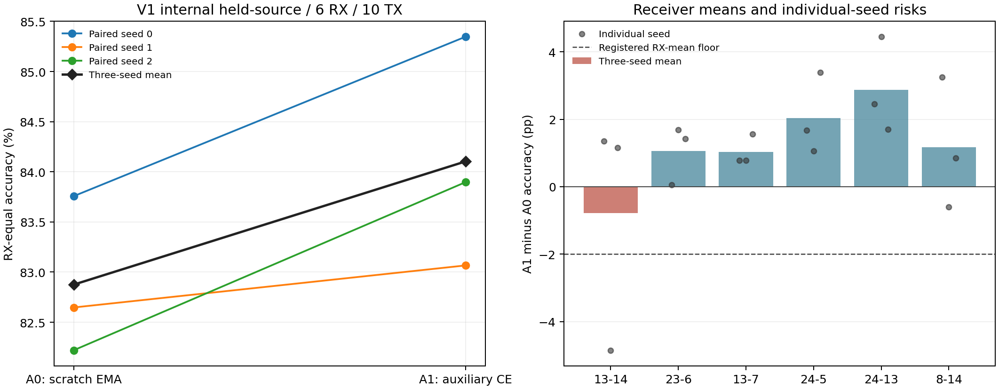

# W5-A结题：固定A1的V1跨源视图复现

**正式决策：`W5A_PASS_CROSS_VIEW_SOURCE_REPLICATION`。** A1通过本轮三项跨视图源侧复现门；普通辅助监督预训练的有效性证据增强，但没有建立新的物理机制。 W5-B未启动，A2当前关系项STOP不变。

## 最终10类分类结果

这里评估的是原C **V1内部源域留RX**：三个配对seed、六RX等权、11,500包/模型。不是实际目标CRD、D3/D4或公开SOTA。V1曾用于C/W2，属于相对本轮训练隔离的跨视图复现，不能称历史全新盲测。

| 方法 | RX等权Accuracy | RX等权Macro-F1 | 最差RX（先平均三seed） |
|---|---:|---:|---:|
| A0 | 82.8748% | 79.5345% | 70.0667% |
| A1 | 84.1043% | 80.6940% | 71.2333% |

| seed | A0 Accuracy (%) | A1 Accuracy (%) | 配对差 (pp) |
|---|---:|---:|---:|
| 0 | 83.7570 | 85.3482 | +1.5912 |
| 1 | 82.6471 | 83.0667 | +0.4196 |
| 2 | 82.2204 | 83.8980 | +1.6776 |

A1−A0均值 **+1.2295pp**，**3/3** seed正向；95%条件RX区间 **[+0.2961, +2.0391]pp**。先平均seed后的最差RX配对差为 **-0.7833pp**；逐seed×RX最坏差为 **-4.8500pp**。

| 事前固定判定 | 结果 |
|---|---|
| A1_vs_A0_gain_ge_1pp | PASS |
| all_three_seed_gains_positive | PASS |
| worst_seed_averaged_RX_vs_A0_ge_minus2pp | PASS |

## 每个接收机与单条训练轨迹

| V1内部留出RX | A0 seed均值 (%) | A1 seed均值 (%) | A1−A0 (pp) |
|---|---:|---:|---:|
| 13-14 | 89.2333 | 88.4500 | -0.7833 |
| 23-6 | 94.0526 | 95.1053 | +1.0526 |
| 13-7 | 82.5741 | 83.6111 | +1.0370 |
| 24-5 | 77.2222 | 79.2593 | +2.0370 |
| 24-13 | 84.1000 | 86.9667 | +2.8667 |
| 8-14 | 70.0667 | 71.2333 | +1.1667 |

| seed | 最差配对差RX | 配对差 (pp) | A1最低绝对Accuracy RX | 其Accuracy |
|---|---|---:|---|---:|
| 0 | 23-6 | +0.0526 | 8-14 | 73.3500% |
| 1 | 13-14 | -4.8500 | 8-14 | 70.1000% |
| 2 | 8-14 | +0.8500 | 8-14 | 70.2500% |

三seed平均后的风险门不能掩盖单条轨迹的局部退化。完整36组RX指标、360组TX×RX支持/错误与6组全包指标分别见[P_RX_METRICS.csv](P_RX_METRICS.csv)、[P_TX_RX_RISKS.csv](P_TX_RX_RISKS.csv)、[P_PACKET_METRICS.csv](P_PACKET_METRICS.csv)。每种方法Macro-F1均计全部10标签，零分母0；缺失支持单列。RX等权F1与全包F1分开，不混用。

区间对同RX先平均三seed后，六RX聚类bootstrap10,000次，seed43101；固定三套已训练模型，条件于多次开发的内部RX。它不涵盖新设备/训练总体的不确定性，区间下界不是第四个晋级门。没有把包数或seed数当成独立接收机数。

## 资格审计：保留同一72TX与样本预算

先读取官方计数元数据。V1合法fit12与ManyTx交集为7台RX；枚举全部7种六RX组合，只有 **14-7、18-19、18-2、7-14、7-7、8-7** 能完整保留W4的原72TX及每格32 raw包。其余六组合均包含8-8，缺少TX20-1。没有按Accuracy挑选RX、替换TX或改变原角色；完整表在[QUALIFICATION.json](QUALIFICATION.json)。

六RX均在V1 fit12，并与V1 source-selection6严格无交。目标ManyRx/ManySig TX并集11台全部排除。72辅助TX的身份、顺序与W4一致；D1/D2每TX×RX×日期前24包训练、后8包checkpoint验证，共20,736/6,912包。只读取这864单元，额外24TX本轮未读。新预训练改变了合法捕获RX，**没有从V0已训练权重初始化**：V0预训练见过V1留出RX13-7/8-14，直接搬运会泄漏。

单体ManyTx索引只读头部，seek跳过21,600个数值数组；元数据读取1,512,134字节，与数值载荷交集0，详见[INDEX_QA.json](INDEX_QA.json)。随后只解码白名单行，记录原始单元SHA与offset。整文件哈希是opaque身份校验，不将其解释成全部IQ已解码。

下游保持V1原16,173 train、6,995 checkpoint-val、11,500 source-selection及其顺序。A0三份初始化、全部训练/验证身份和原验证logits逐比特重放一致后复用；未重新训练A0。新六个所选模型及三份A0身份先封存，迁移审计通过并提交，再读取内部留出IQ；六组预测也先提交封存，再计算最终指标。

## 固定实现、预算与成本

[p_models.py](p_models.py)与W4字节相同；fit_aux函数AST相同；数据函数仅V1审计日志标签变化。共享下游C fit_loop未改。合成工程1次、12更新后，所选权重及完整epoch记录与W4 A1逐比特相同，另7项测试通过。保留CE+0×关系监控只为复现原计算路径，lambda固定0，没有新关系学习、初始梯度探针或调参；遗留文件名P_INITIAL_GRADIENT_SCALES.json内本轮只存随机初始SHA与固定lambda0。

正式科学拟合 **6次=3辅助+3下游**；总更新 **28,200**。每辅助模型40epoch×108=4,320步，每下游40epoch×127=5,080步。每辅助batch8TX×6RX×4包，BN仅用辅助fit数据；下游重新建立与A0相同的10类随机头，迁移所选EMA骨干/BN，并重置Adam/Plateau/EMA。同seed下全部40轮样本顺序、头部与优化器重置已检查。选模均为对应fit RX验证CE最早最小值，不看内部留出结果。

实际六次循环累计 **506.0秒（8.43分钟）**，不含科研整理及完整I/O时间；[逐拟合成本](P_TRAINING_COST.csv)。下游仍 **82,426参数**，辅助72类头 **86,456参数**，迁移时丢弃。A1额外数据和额外训练计算同时存在，不能只写“零成本提升”。

| 方法 | batch1中位时延均值 (ms) | batch128中位时延均值 (ms) |
|---|---:|---:|
| A0 | 2.5811 | 2.4498 |
| A1 | 2.4281 | 2.4939 |

FP32、RTX4060 Laptop、CUDA内固定合成输入、20预热/100测量；不含主机/磁盘I/O，架构相同，微小时延差不是效率创新。

## 与W4一起解释

| 视图 | A0 Accuracy | A1 Accuracy | A1−A0 | 正向seed |
|---|---:|---:|---:|---:|
| V0（W4历史） | 89.4873% | 91.6902% | +2.2029pp | 3/3 |
| V1（本轮） | 82.8748% | 84.1043% | +1.2295pp | 3/3 |

两视图分别按其RX/seed协议报告，不把跨视图均值替代预注册V1三门，也不把双方RX轮换的源侧研究称为独立目标CRD。A1同时增加辅助数据与优化预算；TX多样性、RX多样性和训练更长的因果作用尚未拆开。无论本轮通过与否，都没有证明普通辅助监督预训练本身是原创算法，也没有建立统一物理机制。

A1通过本轮三项跨视图源侧复现门；普通辅助监督预训练的有效性证据增强，但没有建立新的物理机制。 当前只保留A1研究资产；W5-B的长训练/RX多样性对照未运行，须另行界定预算与资格。W4-A2、W1/W2/W3/P2/F2/M1各自STOP不变，W4-E仍为历史补充，不据旧held结果继续调融合。LoRa稿件/模型只读；没有实际目标RX、D3/D4、外层历史held6 IQ、Shen读取或新下载。

## 证据与复算

[预注册](PREREGISTRATION.zh-CN.md)、[执行注册](EXECUTION_REGISTRATION.json)、[模型封存](P_MODEL_SEAL.json)、[评测注册](P_EVALUATION_REGISTRATION.json)、[预测封存](P_PREDICTION_RECEIPT.json)、[迁移/顺序核验](P_TRAINING_QA.json)、[独立复算](INDEPENDENT_QA.json)、[审阅包清单](REPLAY_FILES.json)。

独立NumPy审计通过2106项检查，重新计算分类、F1、CE、bootstrap与三门，核验全部角色/权重/预测/记录SHA。另做异目录解压复算。审阅包包括6份新所选权重、3份复用A0权重、六组留出预测及辅助/下游验证预测、完整角色元数据和选模历史；不含原始IQ、优化器或epoch中间权重。复算范围是保存预测到统计结论及训练证据审计，不是从IQ重新训练。操作见[REPLAY.md](REPLAY.md)。
